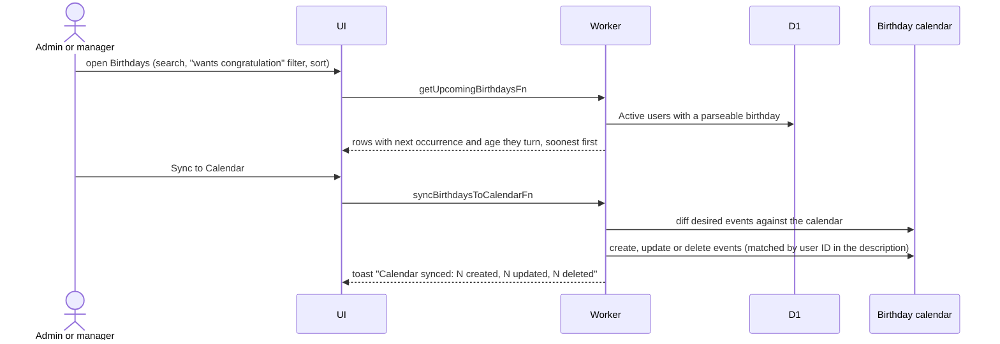
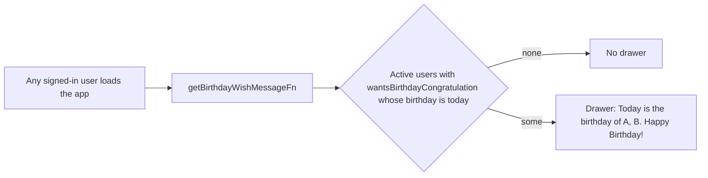

# Birthdays

The Birthdays tab lists upcoming birthdays of **Active** people who have one on file. Only Active counts (`BIRTHDAY_STATUSES`). One dedicated Google Calendar holds one all-day yearly event per such person; its ID is set in admin Settings, falling back to a built-in default.

## How are birthdays listed and kept in the calendar?

- The same reconcile runs automatically when a member changes status ([list](list.md)), finishes onboarding or edits their profile. Failures there are logged, never blocking.
- Unparseable birthdays are skipped.

## What is the birthday wish?

- Shown to everyone, not only admins. People who opted out of congratulations are left out.
