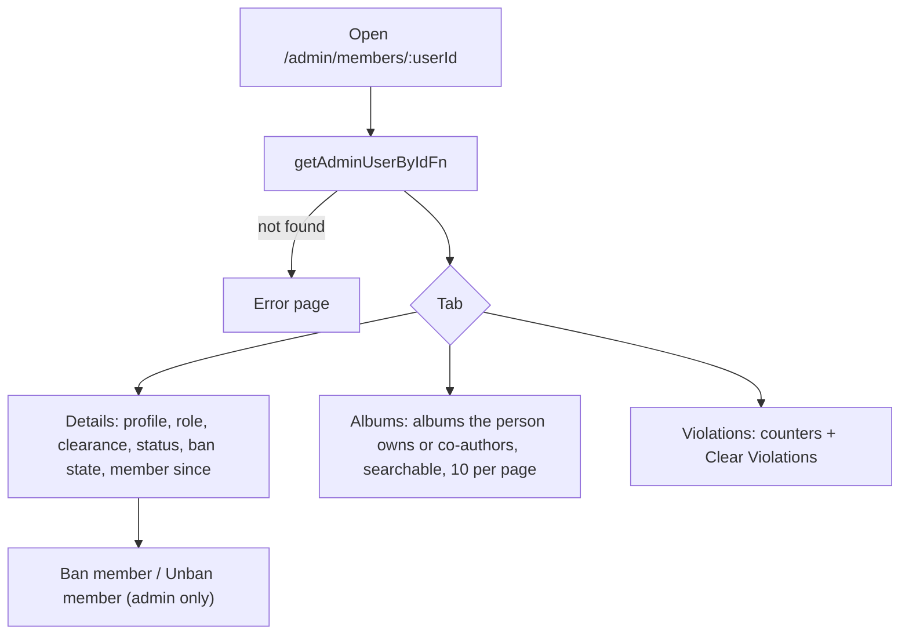

# Member detail

`/admin/members/:userId` opens from the [list](list.md) and from every list that links a person (flamekeepers, violations, birthdays). It works for any account, members or not.

## What does an admin see on a member, and what can they do there?

- Details shows name, email, role, clearance, status, ban date and reason, Instagram, NU ID, birthday, major, graduation year, member since and ID.
- The Albums tab loads separately (`getAdminUserAlbumsFn`) and leaves out deleted albums. Sorting is by title, date or co-author count.
- Clear Violations is in [violations.md](violations.md). Banning is in [ban.md](ban.md). Role, status and clearance are not editable here; use the [list](list.md).
