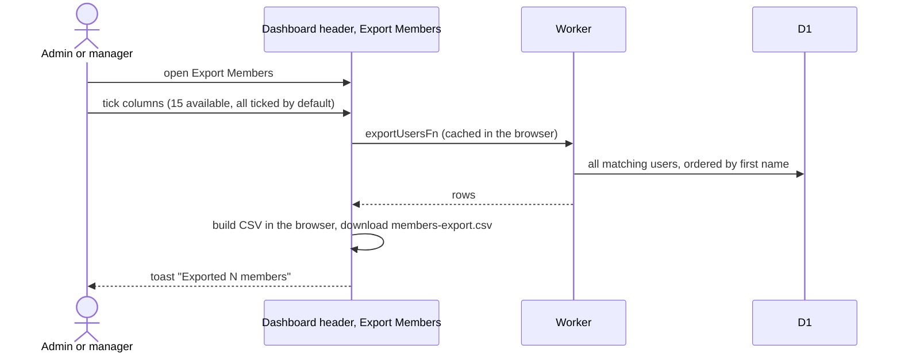

# Export members to CSV

## How does an admin export members?

- The button is in the dashboard header menu and passes no filters, so every user is exported, including non-members. The server accepts role, status, clearance and search filters, but no screen sets them.
- At least one column must stay ticked.
- Columns: full name, email, role, status, clearance, NU ID, Instagram, Telegram, major, graduation year, birthday, member since, auto-cancelled, overdue, albums.
