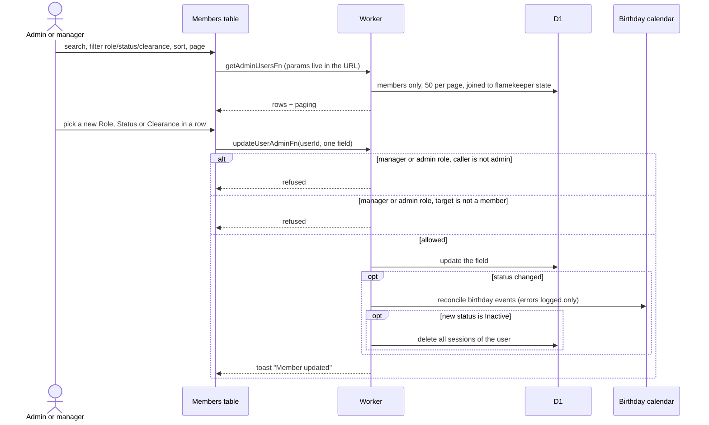
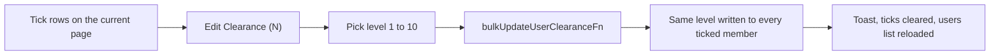

# Club Members list

Club Members (`/admin/members`) lists people with `isMember = true`. Admins and managers see it. The Birthdays and Violations tabs sit beside it. Terms: [Member status](../../../../GLOSSARY.md), [ADR-0020](../../../adr/0020-member-status-separate-from-flamekeeper-state-and-ban.md).

## How do admins find members and change their role, status or clearance?

- Search matches first name, last name and email. Row click opens [the detail page](detail.md); clicks on selects, links and checkboxes do not.
- Role, status and clearance are inline selects. Manager and Admin options are disabled for managers in the UI and refused again on the server.
- Inactive signs the person out everywhere and blocks the next sign-in. Active, Inactive and Alumni are set by hand here.

## How does bulk clearance work?

- Clearance is the only bulk action on this table. Banning several people at once exists only on the [flamekeepers table](../flamekeepers/).
- Ticks are tracked by row position. After changing page, check the count on the button before confirming.
- The equipment table uses the same dialog, see [Equipment list](../equipment/list.md).
