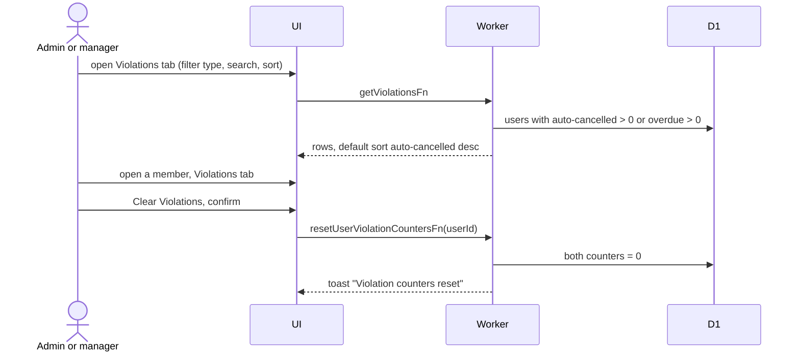

# Violations

The Violations tab lists members with a counter above zero. Two counters live on the user: `cancelledInStartWindowCount` (no-shows, auto-cancelled by the cron) and `overdueCount` (items that went overdue). Overdue forgiveness lowers `overdueCount` by one. See [Glossary](../../../../GLOSSARY.md) and [cron](../../cron/).

## How do admins review and clear violations?

- Clearing changes no booking. The button is disabled while both counters are zero.
- The type filter is Auto-cancelled or Overdue. Rows link to [member detail](detail.md).
