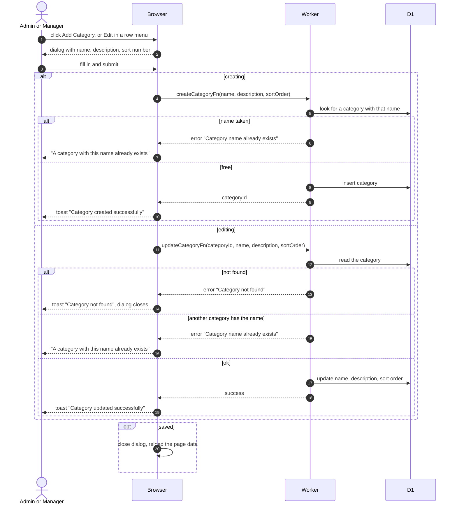

# Create Or Rename A Category

> **Question:** What happens when an admin or manager creates or edits an equipment category?
>
> **Answer:** The person presses Add Category, or opens a row's menu and picks Edit. In the Create New Category or Edit Category dialog they fill in a name, an optional description and a sort number (0 or more) and save. Names must be unique across all categories. A duplicate name shows the message "A category with this name already exists" under the name box. On success the dialog closes, a toast says "Category created successfully" or "Category updated successfully", and the list reloads.
>
> **Notes:**
> - The Create button is disabled while the name is blank. The Save button in the edit dialog is disabled while the name is blank or nothing has changed.
> - If the category was deleted by someone else while the edit dialog was open, the toast says "Category not found" and the dialog closes.
> - A blank description is stored as nothing (null). Names are compared exactly as typed after trimming spaces.
> - Any other error from the server is shown as a toast with its own message.
> - Ordering by dragging is in [categories-list.md](categories-list.md).

