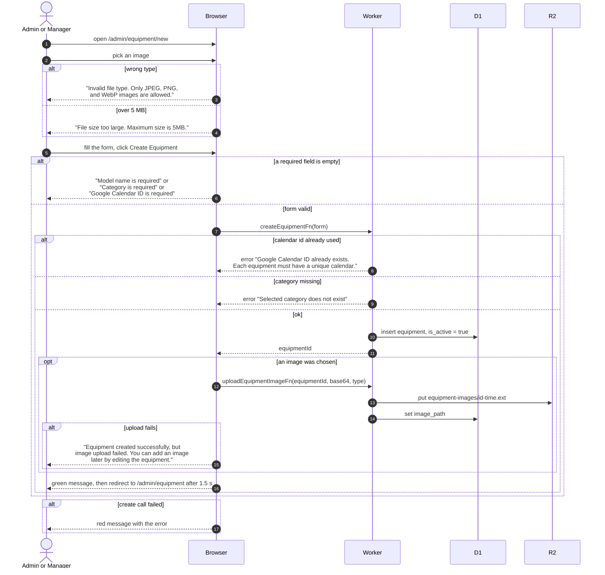

# Add New Equipment

> **Question:** What happens when an admin or manager adds a new piece of equipment, with or without a photo?
>
> **Answer:** The person opens Add Equipment (page /admin/equipment/new), fills in model name, category, Google Calendar ID and required clearance (1 or more), optionally short name, description and an image, and presses Create Equipment. The equipment is created as active, then the image is uploaded if one was chosen. A green message says the equipment was created, and after 1.5 seconds the page goes to the equipment list. If only the image upload fails, the equipment still exists and the page says so.
>
> **Notes:**
> - Every item needs its own Google Calendar ID, because bookings for that item are written to that calendar. A duplicate ID is refused.
> - The image is read in the browser, sent as base64 to the server and stored in R2 under equipment-images/{equipmentId}-{time in ms}.{jpeg, png or webp} (jpg if the browser reports image/jpg). Nothing expires. A later upload gets a new key and the old image is not deleted.
> - The browser checks the image type and the 5 MB limit as soon as the file is picked, and shows the error in the red message. The server checks both again, then checks the equipment exists.
> - The category choices come from the member catalog call, which returns nothing to an account whose own clearance level is under 2. Such an account sees an empty category list.
> - When the image fails, the red message is followed by the green created message, so both appear.
> - The form does not refresh any list. The list page loads its own data when opened.

