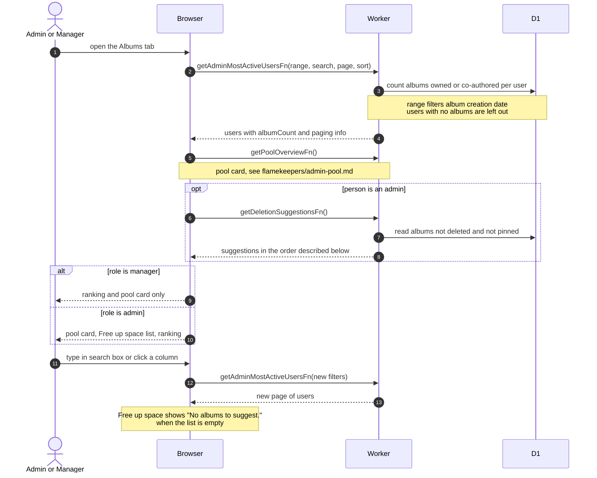

# Dashboard Albums Tab

> **Question:** What does the dashboard Albums tab show, and who sees which part?
>
> **Answer:** The tab lists the club's most active album makers for the chosen date range, ranked by the albums they own plus the albums they co-authored, with search, sorting and paging. Admins also get a Free up space list of albums that could be expired, with unpinned albums that nobody favorited first. Managers see the ranking and the storage pool card but not the Free up space list. Nothing here changes data. Expiring an album is a separate action.
>
> **Notes:**
> - The tab loads its data only when it is opened. The default is 10 rows, sorted by album count, highest first.
> - Only people with at least one album in the range appear in the ranking. The ranking counts deleted albums too, and the same date range as the Overview tab applies.
> - The Free up space order is: albums with no favorites before favorited ones, then soonest expiry (never-expiring last), then biggest size. Pinned and deleted albums are left out.
> - The pool card on this tab is documented in [../flamekeepers/admin-pool.md](../flamekeepers/admin-pool.md).
> - Expiring an album from the list is in [expire-album-early.md](expire-album-early.md).

