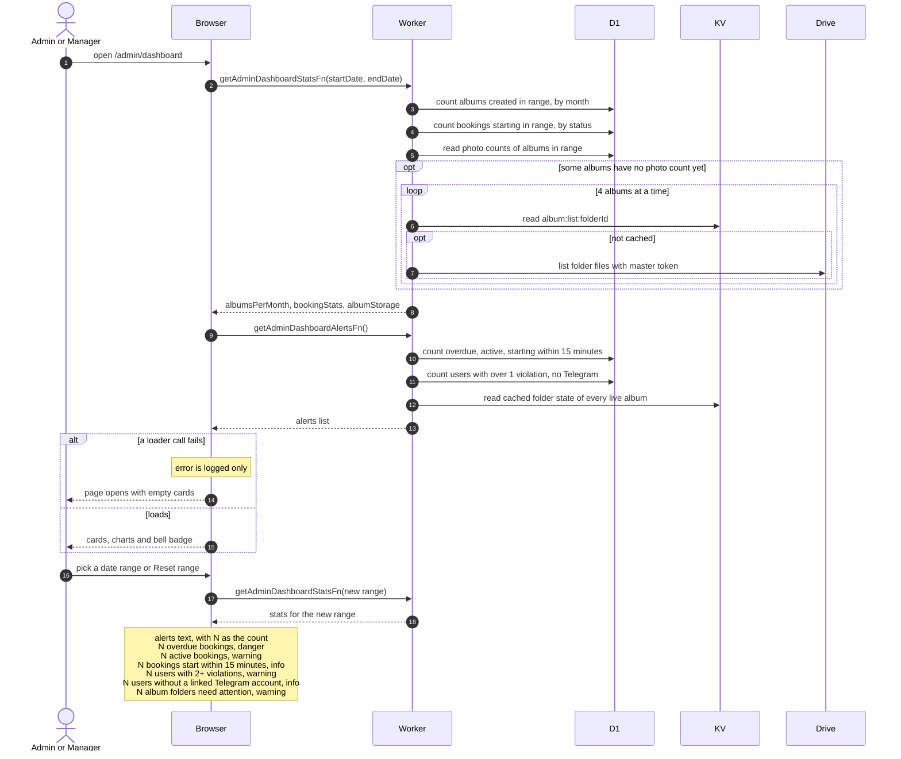

# Dashboard Overview And Alerts

> **Question:** What does an admin or manager see when they open the dashboard, and where do the numbers come from?
>
> **Answer:** The Overview tab shows booking counts by status, albums created per month and photo storage for a date range, which is the current month until the person picks another. A bell menu lists alerts such as overdue bookings, users with repeated violations and album folders in the Drive bin. If a loader fails the error is only logged and the page still opens with empty cards.
>
> **Notes:**
> - The range filters bookings by their start time and albums by creation time. Deleted albums are left out.
> - Stats stay fresh for 60 seconds in the browser. Alerts reload by themselves every 60 seconds.
> - An album whose photos are not yet counted in the database is counted by listing its Drive folder. It uses the master section of the album's KV listing when that is complete, so the Drive is called only for albums without one.
> - A Drive "not found" for one album is skipped silently. Any other Drive error is logged and that album adds nothing to the totals.
> - Alerts about album folders use only what KV already holds and never call Drive.
> - The Telegram alert counts every account without a linked chat, not only club members.
> - Picking a date range or pressing Reset range changes the URL and reloads the stats.

