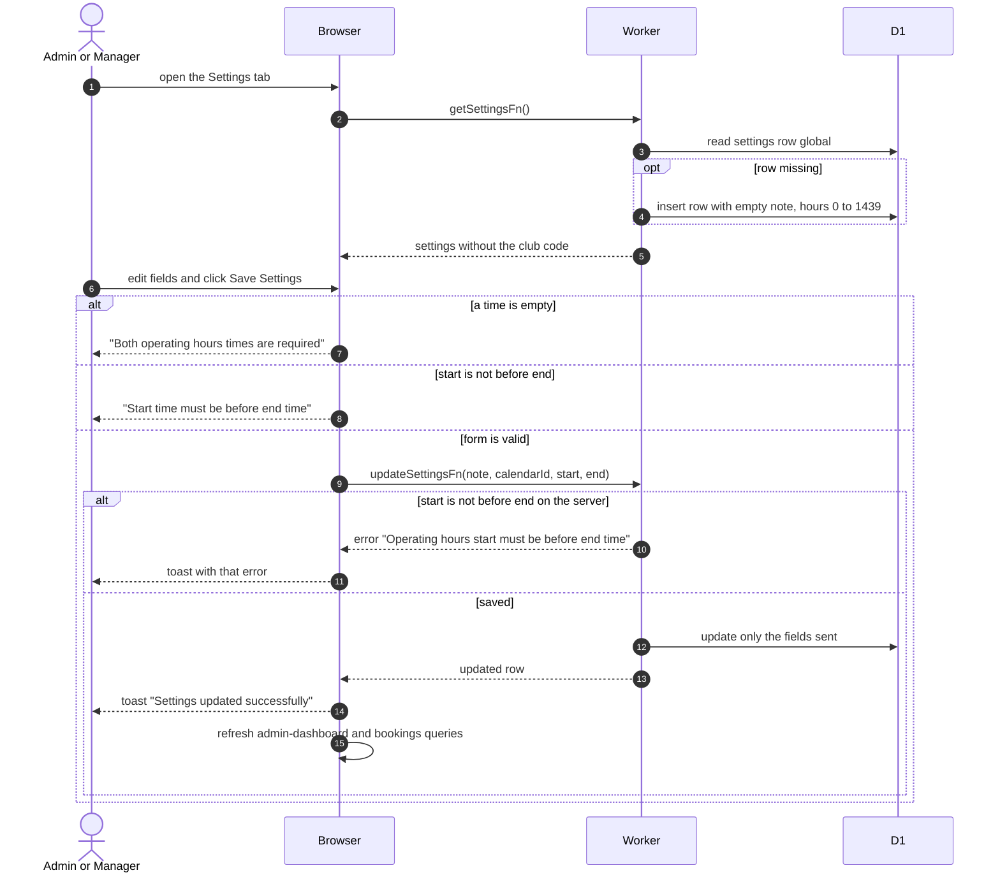

# Club Settings

> **Question:** How does an admin or manager change the booking note, the birthdays calendar or the daily opening hours?
>
> **Answer:** On the dashboard Settings tab the person edits the global booking note, the birthdays calendar ID and the start and end of the daily booking window, then presses Save Settings. The form refuses to save when either time is empty or the start is not before the end. On success a toast says "Settings updated successfully" and the dashboard and booking data reload.
>
> **Notes:**
> - The settings are one shared row. If it does not exist yet, opening the tab creates it with an empty note and hours 00:00 to 23:59.
> - Times are stored as minutes after midnight, from 0 to 1439. The preview line under the form shows the bookable hours and the number of 30-minute slots per day.
> - Only the fields sent are changed. The server repeats the start-before-end check and refuses with "Operating hours start must be before end time".
> - The club code lives in the same row but is never returned by getSettingsFn. See [club-code.md](club-code.md).
> - An empty birthdays calendar ID falls back to the built-in default calendar when birthdays are synced, see [sync-birthdays.md](sync-birthdays.md).

