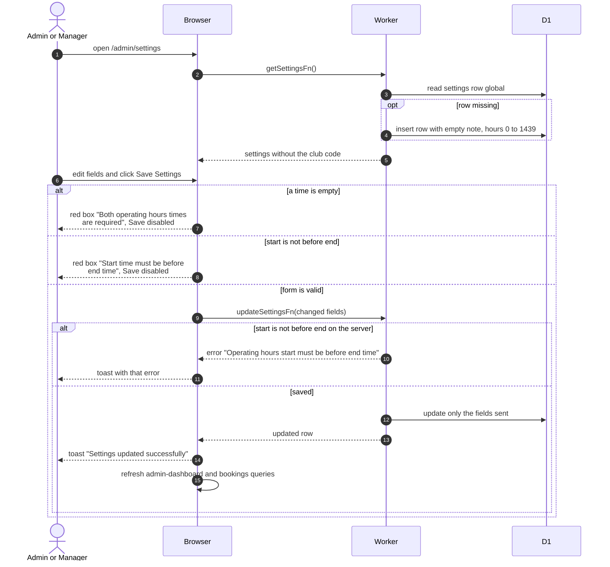

# Club Settings

> **Question:** How does an admin or manager change the booking note, the birthdays calendar, the daily opening hours or the storage alerts?
>
> **Answer:** The Settings page (/admin/settings) has line tabs Bookings, Albums, Members, Flamekeepers and Storage, each with its own Save button, and number settings are shown as rows (Items) with a label, helper text and an input. The Bookings tab holds the global booking note and the start and end of the daily booking window, the Members tab the birthdays calendar ID (and the club code, see club-code.md), the Albums tab the scheduled deletion period in days, the Flamekeepers tab the lost-flamekeeper grace and graduation prompt lead in days, and the Storage tab the Buffer limit and Buffer alert (% used) and, for admins, the Flamekeepers per-account cap and the Pool-low alert (% used, default 90, range 50 to 99). The Pool-low alert fires when the used share of the pledged space reaches that percentage, see ../cron/flamekeepers/pool-top-up.md. The Bookings form below is the example; the Save button is disabled when either time is empty or the start is not before the end, and a red box says why. The Save Settings button is disabled when either time is empty or the start is not before the end, and a red box says why. On success a toast says "Settings updated successfully" and the dashboard and booking data reload.
>
> **Notes:**
> - The settings are one shared row. If it does not exist yet, opening the tab creates it with an empty note and hours 00:00 to 23:59.
> - Times are stored as minutes after midnight, from 0 to 1439. The preview line under the form shows the bookable hours and the number of 30-minute slots per day.
> - Only the fields sent are changed. The server repeats the start-before-end check and refuses with "Operating hours start must be before end time".
> - The club code lives in the same row but is never returned by getSettingsFn. See [club-code.md](club-code.md).
> - An empty birthdays calendar ID falls back to the built-in default calendar when birthdays are synced, see [sync-birthdays.md](sync-birthdays.md).

