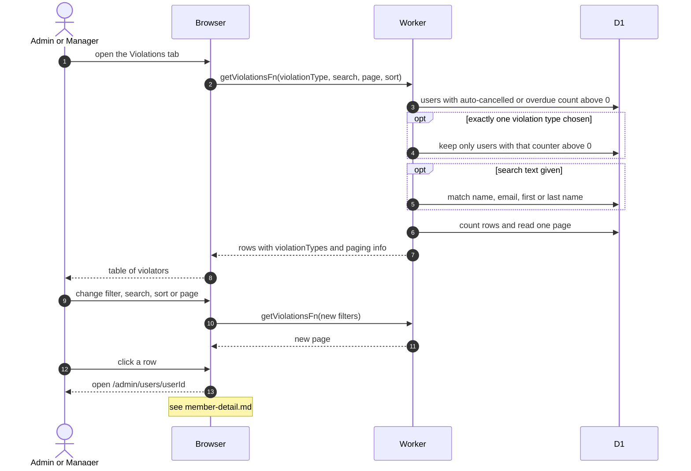

# Dashboard Violations List

> **Question:** How does an admin or manager find members who keep missing pickups or returning late?
>
> **Answer:** The Violations tab lists every user whose auto-cancelled count or overdue count is above zero, with the two counts, role and status. It can be filtered by violation type, searched by name or email, sorted and paged. Clicking a row opens that member's detail page, where the counters can be cleared.
>
> **Notes:**
> - Choosing both violation types is the same as choosing none, because the list already shows users with either one.
> - The counters are raised when a booking is auto-cancelled for not starting or goes overdue, see [../cron/bookings/](../cron/bookings/).
> - The bell alert "N users with 2+ violations" counts users with either counter above 1, a stricter test than this list.
> - Default sort is auto-cancelled count, highest first, 10 rows per page.
> - Clearing counters is in [member-detail.md](member-detail.md).

