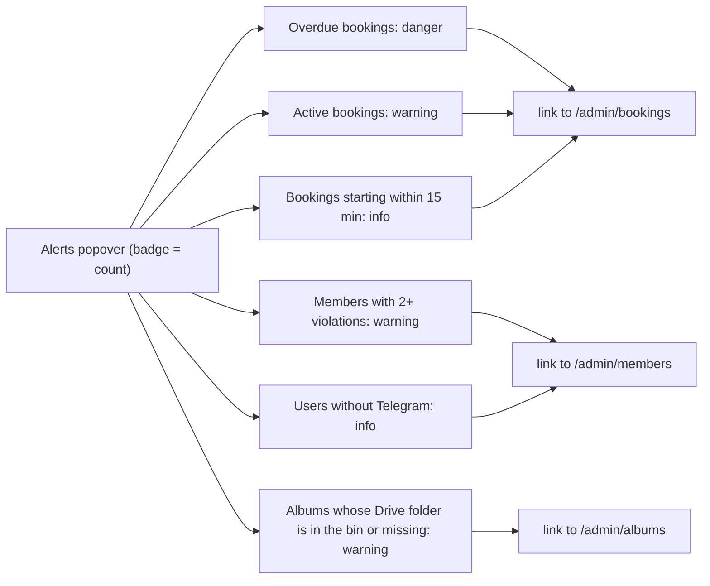
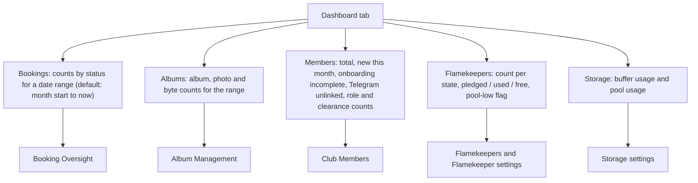

# Dashboard

`/admin/dashboard` is for admins and managers. A header (Alerts, Quick Actions, and for admins a test-email button) sits above five tabs: Bookings, Albums, Members, Flamekeepers, Storage.

## What do the Alerts show?

Each alert appears only when its count is above zero; otherwise the popover reads "All clear". The album check uses cached folder state and never calls Drive.

## What does each tab show and where does it lead?

- Quick Actions link to Club Members, Add Equipment and Bookings, and offer Export Members; admins also get Broadcast ([settings/broadcast.md](../settings/broadcast.md)).
- The Flamekeepers tab shows the `drained` state as "Stopped", like everywhere else.
- Storage numbers and the thresholds behind them: [settings/storage.md](../settings/storage.md), [pool.md](../flamekeepers/pool.md).
