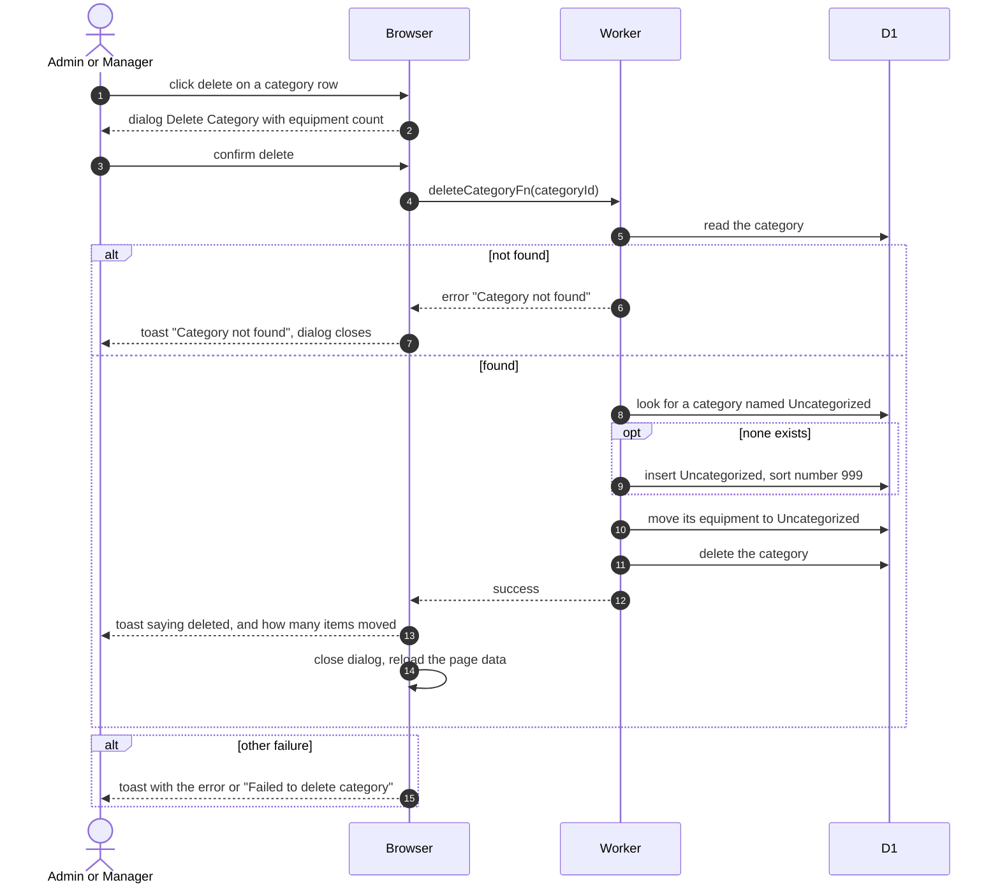

# Delete A Category

> **Question:** What happens to the equipment when an admin or manager deletes a category?
>
> **Answer:** The category is removed for good and every piece of equipment in it moves to a category named Uncategorized, which is created on the spot if it does not exist yet. The dialog warns about this beforehand. The toast says either "Category "name" deleted successfully" or, when equipment moved, "Category "name" deleted and N equipment items moved to "Uncategorized"". The list then reloads.
>
> **Notes:**
> - A new Uncategorized category gets the description "Default category for equipment without specific categories" and sort number 999, so it lands at the end.
> - If the category is already gone, the toast says "Category not found" and the dialog closes. Any other error is shown as its own toast.
> - The equipment move and the delete are separate steps, so a failure between them leaves the equipment moved and the category still present.

