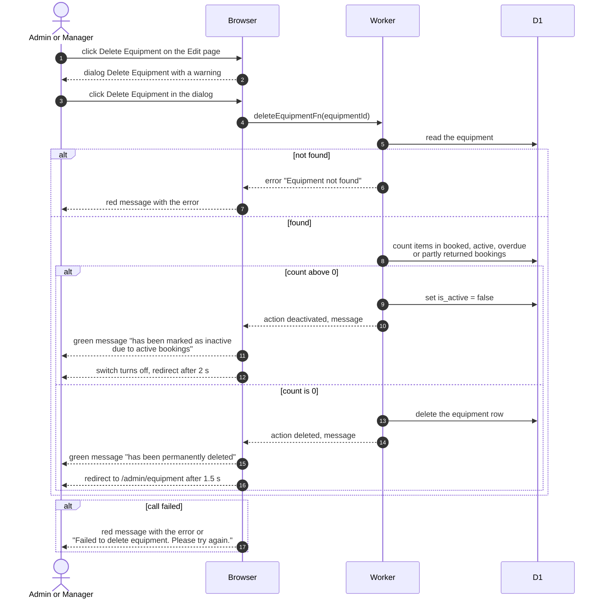

# Delete Equipment

> **Question:** What happens when an admin or manager deletes a piece of equipment that has bookings?
>
> **Answer:** If any booking that is still booked, active, overdue or partly returned includes the item, it is not deleted. It is switched to inactive so it can no longer be booked and existing bookings carry on, and the page says so. If there is no such booking, the row is deleted for good. Either way the person sees a green message and is taken back to the equipment list.
>
> **Notes:**
> - The confirm dialog already warns about this: "If this equipment has active bookings, it will be marked as inactive instead of being deleted to preserve booking history."
> - After the inactive result the page waits 2 seconds before leaving, and after a real delete 1.5 seconds.
> - Only the booking statuses listed above count as active. Returned and cancelled bookings do not stop a delete.
> - Switching an item on again is done in [edit-equipment.md](edit-equipment.md).

