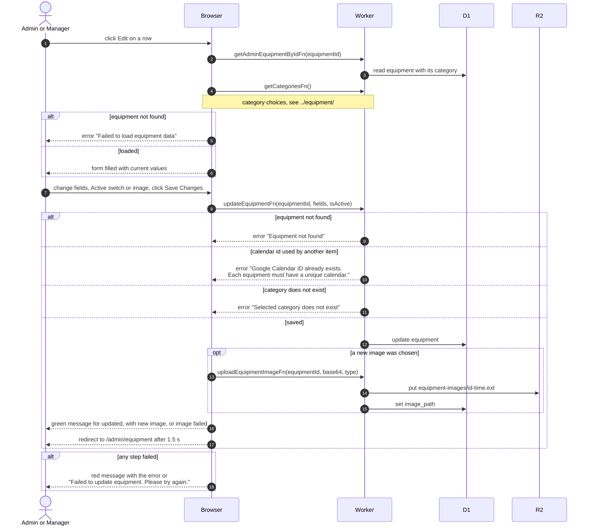

# Edit Equipment

> **Question:** What happens when an admin or manager edits a piece of equipment, switches it off or replaces its photo?
>
> **Answer:** The Edit page loads the item and the category list, and the person changes any field, the Active switch or the image, then presses Save Changes. The server checks that the item exists, that a changed calendar ID is not used by another item and that the category exists, then saves. A green message says the item was updated, and after 1.5 seconds the page goes to the equipment list. Inactive equipment cannot be booked by members.
>
> **Notes:**
> - The text of the green message tells the outcome: updated, updated with new image, or updated but the image upload failed (the person can try the image again).
> - Changing the image uploads a new file to R2 and points the item at it. The previous file stays in R2.
> - The page does not refresh any list. The list page loads its own data when opened.
> - If the item is missing when the page opens, the page shows "Failed to load equipment data".
> - Deleting from this page is in [delete-equipment.md](delete-equipment.md).

