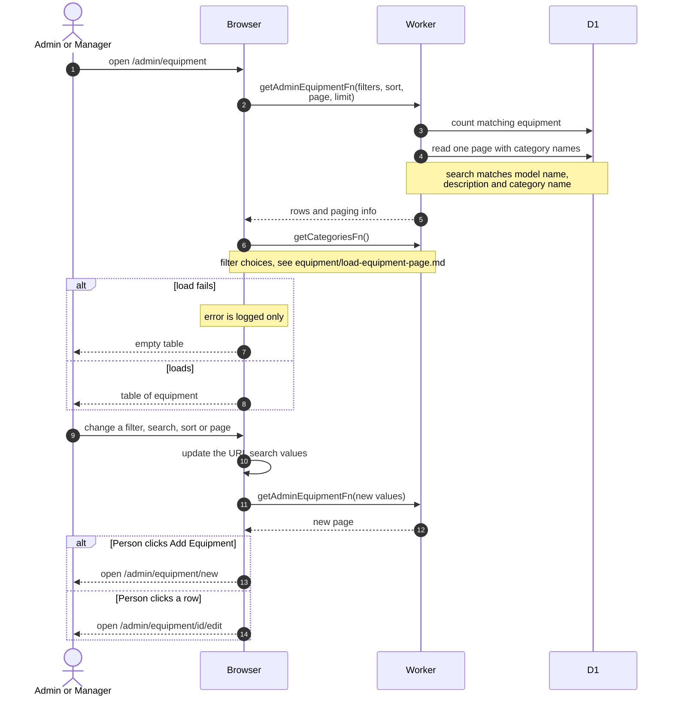

# Equipment Management List

> **Question:** How do admins and managers browse and filter the whole equipment catalog, including inactive items?
>
> **Answer:** Equipment Management lists every piece of equipment, active or not, with its category, required clearance and status. The page has filters for category and status (active or inactive), a search box, sortable columns and paging, 50 rows per page by default. A clearance range can also be set in the address bar, though the page has no control for it. Filters and sort live in the address bar. From the page the person can press Add Equipment, click a row to open its Edit page, or tick rows to change their clearance level together.
>
> **Notes:**
> - The search box is labeled name or description, and the server also matches the category name. Each row has a View link to its Google Calendar.
> - Unlike the member-facing catalog, this list is not limited by the viewer's own clearance level and shows inactive items too, unless an active-state filter is set.
> - The categories used in the filter come from the same call that fills the equipment forms, see [../equipment/load-equipment-page.md](../equipment/load-equipment-page.md).
> - If a list call fails, the error is only logged and the table shows no rows.
> - Bulk clearance is in [bulk-clearance.md](bulk-clearance.md). Adding, editing and deleting are in [create-equipment.md](create-equipment.md), [edit-equipment.md](edit-equipment.md) and [delete-equipment.md](delete-equipment.md).

