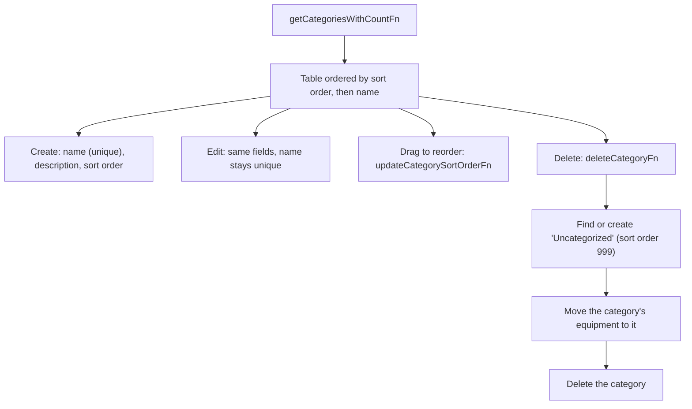

# Categories

`/admin/equipment/categories` manages the groups used to filter the catalog. The table shows each category's equipment count.

## How do admins manage categories?

- Duplicate names are refused with "Category name already exists".
- Deleting never deletes equipment. The toast reports how many items moved to "Uncategorized".
- Members and bulk category edits use these same categories, see [Equipment list](list.md).
