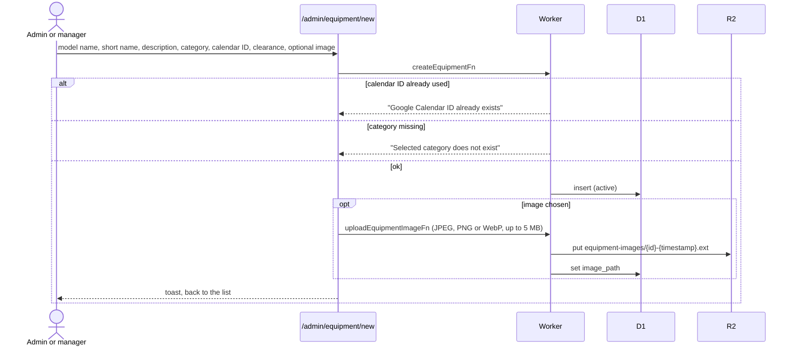
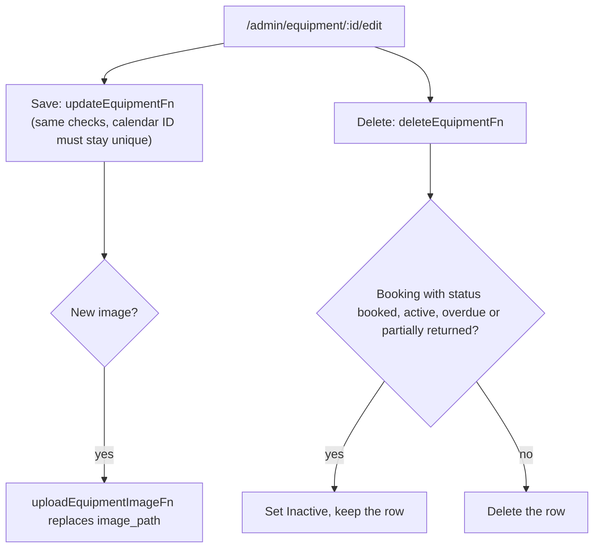

# Create, edit and delete equipment

Each piece of equipment is backed by its own Google Calendar. The admin pastes that calendar's ID; the app does not create calendars.

## How is equipment created?

- If the image upload fails, the equipment still exists; the toast says to add the image by editing.

## How is equipment edited or deleted?

- Single delete only deactivates while open bookings exist. Past bookings do not block it. [Bulk delete](list.md) is stricter: any booking item ever blocks it.
- The old image object is not removed from R2 on replace.
