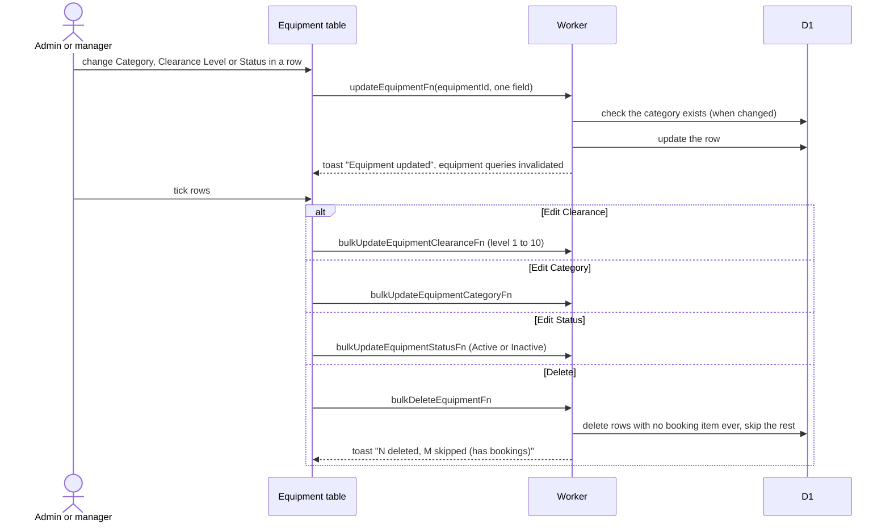

# Equipment list

Equipment (`/admin/equipment`) is the admin catalog. It shows active and inactive equipment, 50 per page, with filters, search (model name, description, category name) and sort kept in the URL. Admins and managers use it. Terms: [Equipment, Category, Clearance level](../../../../GLOSSARY.md).

## How does an admin edit equipment from the list?

- Inactive equipment disappears from the member catalog but keeps its history. Clearance is the level a member needs to book it.
- Each row has a View link to the equipment's Google Calendar. Clicking a row opens the [edit form](form.md).
- Bulk edits write to every ticked id and report the ticked count. Ticks are by row position on the current page.
