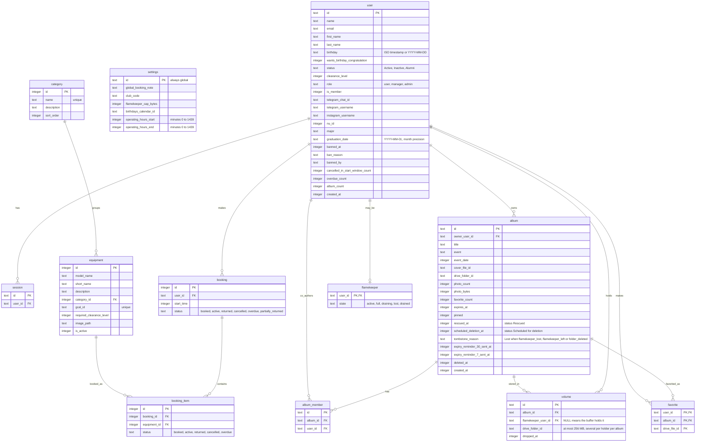

# Admin Data

> **Question:** Which tables and stored values do the admin scenarios read or write?
>
> **Answer:** The admin console works mostly on the user, settings, category and equipment tables. It reads bookings, albums, favorites and flamekeeper rows for counts, lists, the Free up space list and ban follow-up work, and deletes sessions when a person is banned or set to Inactive. Banning also changes the flamekeeper and volume rows through the steps in [ban-member.md](ban-member.md) and [../cron/flamekeepers/ban-cleanup.md](../cron/flamekeepers/ban-cleanup.md).
>
> **Notes:**
>
> - KV: the key album:list:{driveFolderId} holds the album's listings and folder state (ok, trashed or missing) with a TTL of 8 days. The dashboard only reads it, and never writes it.
> - R2: equipment images are stored under equipment-images/{equipmentId}-{time in ms}.{jpeg, png or webp}. They have no expiry, and replaced images are not removed.
> - The settings table has one row, with id global. It also holds the flamekeeper cap and the Pool-low alert percent, set in Settings, Storage, see [../flamekeepers/admin-pool.md](../flamekeepers/admin-pool.md).
> - Only the columns these scenarios use are listed.

