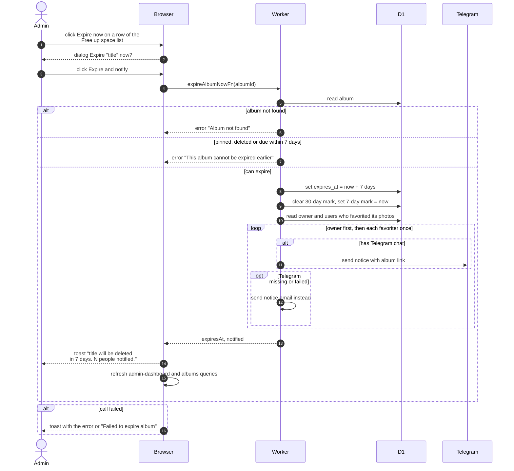

# Expire An Album Early

> **Question:** What happens when an admin presses Expire now on an album in the Free up space list?
>
> **Answer:** The album's deletion date is moved to 7 days from now and the owner and everyone who favorited a photo in it (a photo still live) are told. Nothing is deleted yet. People with a linked Telegram chat get a Telegram message and the rest get an email. The admin sees a toast with the album name and how many people were told. An album that is pinned, already deleted or already due within 7 days is refused.
>
> **Notes:**
> - The 30-day reminder is cleared and the 7-day reminder is marked as already sent, so the cron does not send a second 7-day notice.
> - The owner is always notified first. Each person is told once, even if they are both owner and favoriter.
> - If Telegram fails for someone, the notice falls back to email. The count in the toast covers only people who were actually reached.
> - Without a Telegram bot token, everyone is emailed.
> - The actual deletion happens later in the cron, see [../cron/albums-and-housekeeping/expiry-delete.md](../cron/albums-and-housekeeping/expiry-delete.md).

