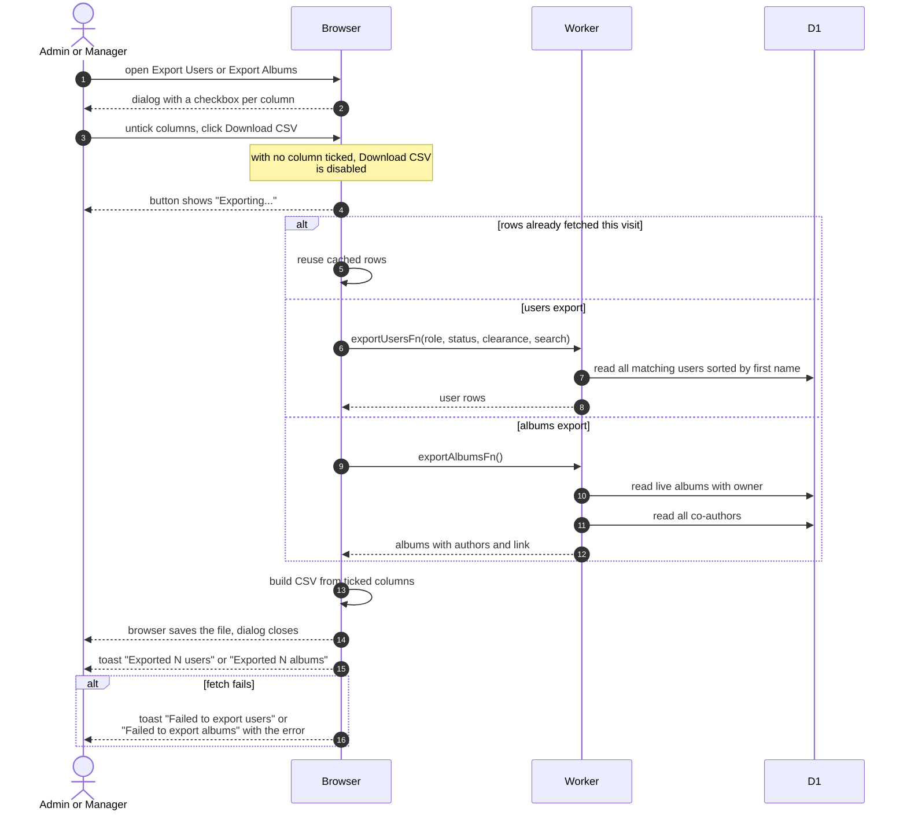

# Export Users Or Albums To CSV

> **Question:** How does an admin or manager download a spreadsheet of members or albums, and can they pick the columns?
>
> **Answer:** Yes. Export Users (on the dashboard Quick Actions menu and on the Members page) and Export Albums (on the album management page) open a dialog with a checkbox for every column, all ticked at first. Pressing Download CSV fetches every matching row, not just the current page, builds the file in the browser and saves it as users-export.csv or albums-export.csv. A toast says how many rows were exported. With no column ticked the Download CSV button is disabled.
>
> **Notes:**
> - The Members page passes its current role, status, clearance and search filters to the export. The dashboard menu exports everyone. The user export is not limited to club members, so alumni and non-members are included.
> - User columns: Full Name, Email, Role, Status, Clearance Level, NU ID, Instagram Username, Telegram Username, Major, Graduation Year, Birthday, Member Since, Auto-Cancelled, Overdue, Albums. Album columns: Event, Event Date, Authors, Authors' Emails, Authors' Telegram, Album Link, Album Date.
> - Columns come out in the order they sit in the ticked list: the dialog's order at first, and a column that is unticked and ticked again goes to the end. Dates are YYYY-MM-DD for users and DD.MM.YYYY for albums. Several authors in one cell are joined with a semicolon.
> - The file starts with a byte-order mark so Excel reads the characters correctly.
> - Fetched rows are kept for the rest of the visit, so a second export of the same filters does not reload the data and can be out of date until the page is reloaded.
> - The album export lists albums not deleted, with owner and co-authors, and builds links from the site address.

