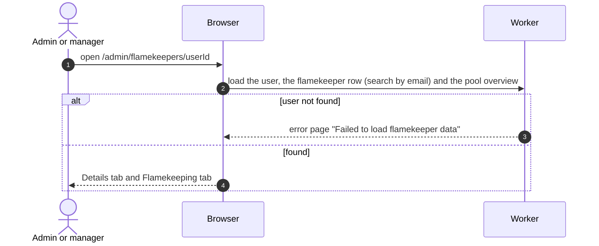

# Flamekeeper detail

## What does the detail page show?

- Details: name (Member badge), email, status, ban state and reason, Instagram, NU ID, birthday, major, graduation year, account age, user ID.
- Flamekeeping: state, pledged, used, available (pledged minus used), Drive usage, the pool's per-account cap, graduation month and last confirmation, last health check, lost-since with the reconnect deadline (7 days later), and flamekeeper-since. A user without a record sees "This user has no flamekeeper record".
- Admins get Ban or Unban in the header, except on their own account.
- States are read-only; nothing here edits a pledge or a state.
