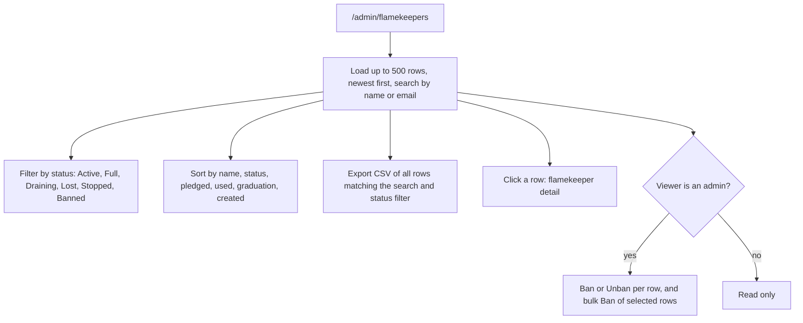

# Flamekeepers list

`/admin/flamekeepers` (Flamekeeper Management) lists every flamekeeper record for admins and managers.

## What can an admin do on the list?

- Status is the flamekeeper state, except a banned user shows Banned whatever their state. Status filtering, sorting and pagination run in the browser over the loaded rows; search is the only server-side filter.
- An admin cannot ban themselves. The ban dialogs and their effects are in the Club Members docs ([club-members](../club-members/)); a ban also ends flamekeeping at once ([ADR-0020](../../../adr/0020-member-status-separate-from-flamekeeper-state-and-ban.md)).
- Statuses are defined in the [GLOSSARY](../../../../GLOSSARY.md) (Flamekeeper).
