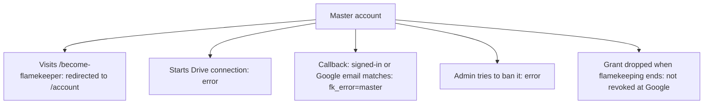

# Master account

The club's master Google account (`GOOGLE_MASTER_EMAIL`) owns every album folder ([ADR-0008](../../../adr/0008-one-club-folder-per-album-photos-owned-by-flamekeepers.md)), so it must never be a flamekeeper or be banned.

## Where is the master account refused?

- Emails are compared ignoring case and spaces. With no `GOOGLE_MASTER_EMAIL` set, nobody is treated as master.
- Messages: "The club account owns the album folders and cannot be a flamekeeper." and "The club account owns every album folder and cannot be banned."
- No flamekeeper row is ever written for it, so nothing can end its flamekeeping. The callback check runs after the token exchange, so a failed exchange shows the token error first ([connect-drive](../../flamekeeper/onboarding/connect-drive.md)).
