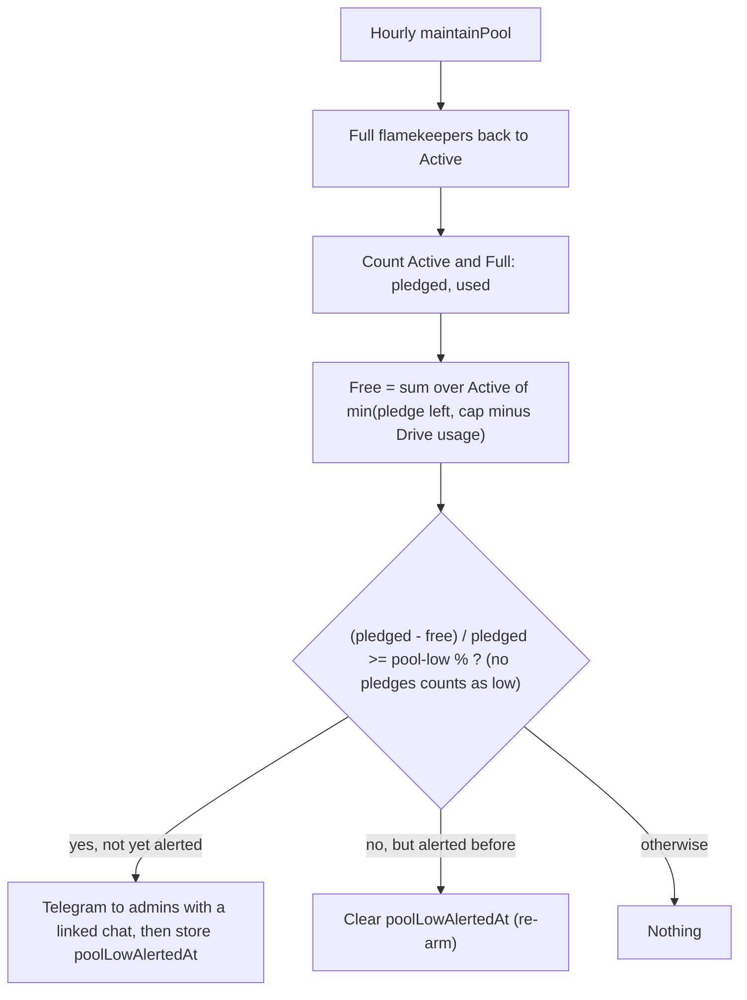

# Pool

The pool is the free pledged space of Active flamekeepers, used only to pick offload destinations ([GLOSSARY](../../../../GLOSSARY.md), Pool). Uploads go to the buffer, not the pool.

## How is the pool measured and when are admins warned?

- One alert per crossing. If the Telegram send is skipped for budget, it is retried next hour.
- The cap per account (default 20 GB, 1-1024) and the pool-low percent (default 90, 50-99) are set in [settings/storage.md](../settings/storage.md).
- Pool numbers are shown on the dashboard Flamekeepers and Storage tabs ([dashboard](../dashboard/overview.md)) and the cap on each [detail](detail.md) page.
- Lost, Draining and Stopped flamekeepers are not counted. Offload, the only user of the pool, is Stage 2 of #15 and not built.
