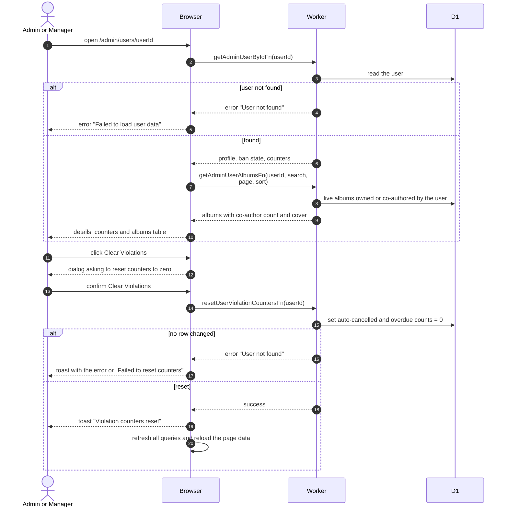

# Member Detail Page

> **Question:** What can an admin or manager see on a member's page, and how do they clear that member's violation counters?
>
> **Answer:** The page shows the person's profile fields, role, clearance, status, ban state, the two booking violation counters and a searchable list of the albums they own or co-authored. Pressing Clear Violations and confirming sets both counters to zero. A toast says "Violation counters reset". Clearing does not change any booking. The Clear Violations button is disabled while both counters are zero.
>
> **Notes:**
> - A person with an unknown id gets the error page "Failed to load user data". The albums list is requested by the page on its own, after the person is loaded.
> - The page works for any account, including non-members and alumni, because the lists link here.
> - The albums table defaults to newest first, 10 per page, and can be sorted by title, date or number of co-authors. Deleted albums are not listed.
> - The Ban section is described in [ban-member.md](ban-member.md) and [unban-member.md](unban-member.md).
> - How the counters go up is in [../cron/bookings/cancel-unstarted.md](../cron/bookings/cancel-unstarted.md) and [../cron/bookings/mark-overdue.md](../cron/bookings/mark-overdue.md).

