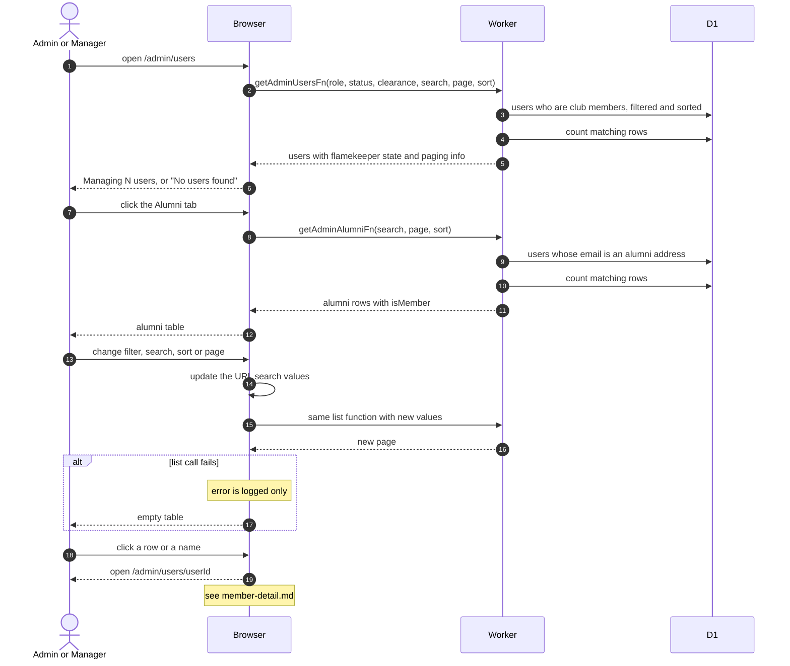

# Members And Alumni Lists

> **Question:** How do admins and managers browse, search and filter club members and alumni?
>
> **Answer:** Manage Users has three tabs. Members lists club members with their role, status, clearance level, album count and flamekeeper state. Alumni lists accounts with an alumni email address, member or not. Flamekeepers is covered elsewhere. Both lists filter, search and sort on the server, keep their settings in the address bar and show 50 rows per page. Clicking a row opens the person's detail page.
>
> **Notes:**
> - The Members list shows only people marked as club members. The Members filters are role, status and clearance level. Search matches name, email, first name and last name.
> - The Alumni list has search and sorting by first name, last name, email and joined date, and shows a Member badge when the account is also a club member.
> - Page, size, filters and sort are part of the URL, so a link or a reload keeps them. Changing a filter reloads the list through the same function.
> - Changing a role, status or clearance from the Members table is in [change-member.md](change-member.md). Clearance for many rows at once is in [bulk-clearance.md](bulk-clearance.md).
> - The Flamekeepers tab is in [../flamekeepers/](../flamekeepers/).

