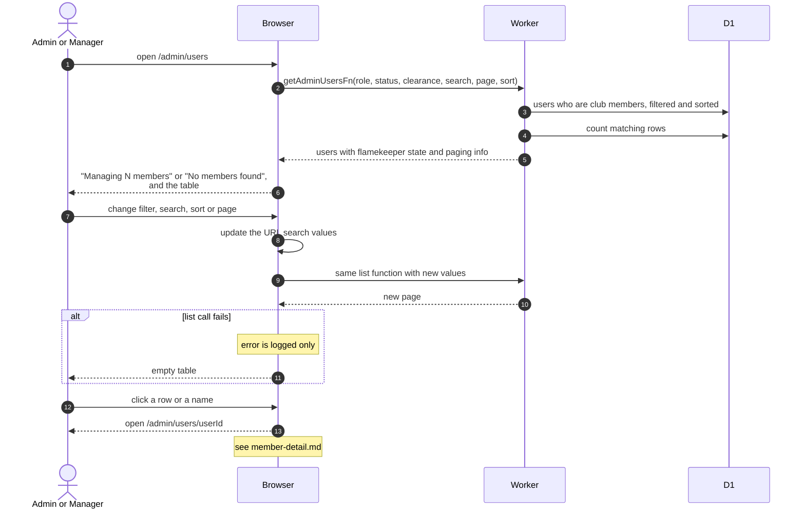

# Members List

> **Question:** How do admins and managers browse, search and filter club members?
>
> **Answer:** Member Management lists club members with their role, status, clearance level and album count, and a Flamekeeper badge on those who are flamekeepers. The list filters, searches and sorts on the server, keeps its settings in the address bar and shows 50 rows per page. Clicking a row opens the member's detail page.
>
> **Notes:**
>
> - The list shows only people marked as club members. The filters are role, status and clearance level. Search matches the name, email, first name and last name fields.
> - Page, size, filters and sort are part of the URL, so a link or a reload keeps them. Changing a filter reloads the list through the same function.
> - Changing a role, status or clearance from the table is in [change-member.md](change-member.md). Clearance for many rows at once is in [bulk-clearance.md](bulk-clearance.md).
> - Flamekeepers have their own page, see [../flamekeepers/admin-flamekeepers.md](../flamekeepers/admin-flamekeepers.md).

