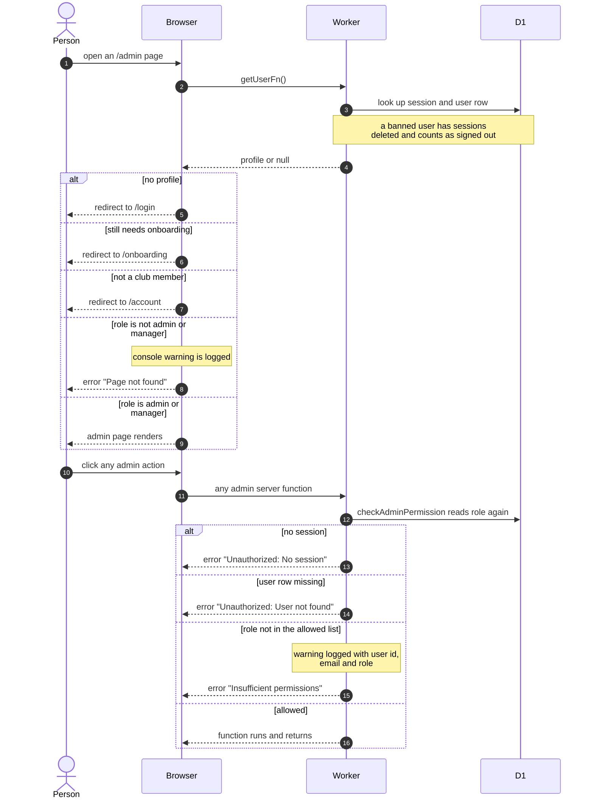

# Admin Route Gate

> **Question:** Who gets into the admin area, and what stops everyone else?
>
> **Answer:** Only a signed-in club member whose role is admin or manager can open any page under /admin. Everyone else is redirected to sign in, onboarding or the profile page, or sees "Page not found". The page check is only the first lock. Every admin server function checks the caller's role again against the database and refuses with a short error if the role is missing.
>
> **Notes:**
>
> - The role is read from the database on every server call, not from the browser, so a role change takes effect on the next click.
> - A banned person's sessions are deleted when the session is looked up, so they are treated as signed out.
> - The sidebar shows the Admin group only to admins and managers. Typing an /admin address by hand still hits the same gate.
> - Which of the two roles may call which function is in [who-can-do-what.md](who-can-do-what.md).

