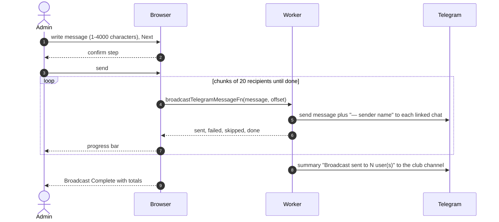

# Broadcast message

Admins can send a Telegram message to every user with a linked chat. Reached from Dashboard, Quick Actions, Broadcast Message, and from Settings, Members. Managers do not see it.

## How is a broadcast composed and delivered?

- Users without a linked chat are skipped and counted. Link status is shown on the dashboard Members tab and as an alert.
- The browser drives the chunking because one Worker invocation cannot deliver a whole broadcast within Telegram rate limits and the subrequest budget. A failed chunk request shows "Broadcast failed"; failures inside a chunk are only counted.
- The club-channel summary is posted once, when the last chunk finishes.
