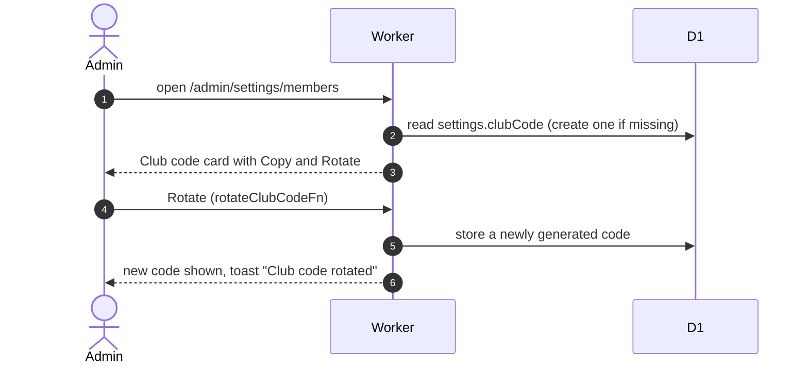

# Club code

The club code is the secret a non-member enters to join the club. Admins see it on Settings, Members, and can rotate it; managers do not see the card.

## How does an admin view and rotate the code?

- Rotating takes effect immediately and old codes stop working; there is no confirmation step and nobody is notified.
- Existing members are unaffected. Matching ignores case and surrounding spaces. How a user enters it: [member account docs](../../member/account/).
