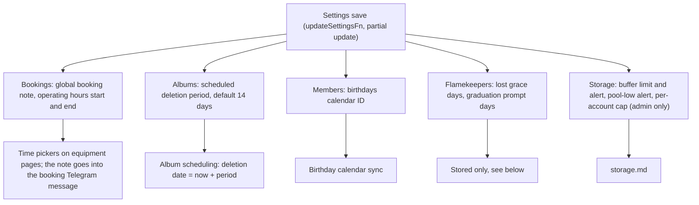

# Other settings

Settings is one `global` row edited across five tabs: Bookings, Albums, Members, Flamekeepers, Storage. `/admin/settings` opens Members. Admins and managers can save every field except the ones marked admin only.

## Which settings exist and who reads them?

- Operating hours start must be before end (minutes from midnight, 0-1439).
- The scheduled deletion period applies when an admin schedules an album for deletion from Album Management ([GLOSSARY](../../../../GLOSSARY.md), Scheduled deletion).
- Lost grace days (default 7) and Graduation prompt lead (default 60) are read by the lost-grace cron step, the reconnect email and the graduation stop ([account card](../../flamekeeper/account/account-card.md), [graduation](../../flamekeeper/account/graduation.md)).
- Club code, broadcast, test email and storage have their own files: [club-code.md](club-code.md), [broadcast.md](broadcast.md), [test-email.md](test-email.md), [storage.md](storage.md).
