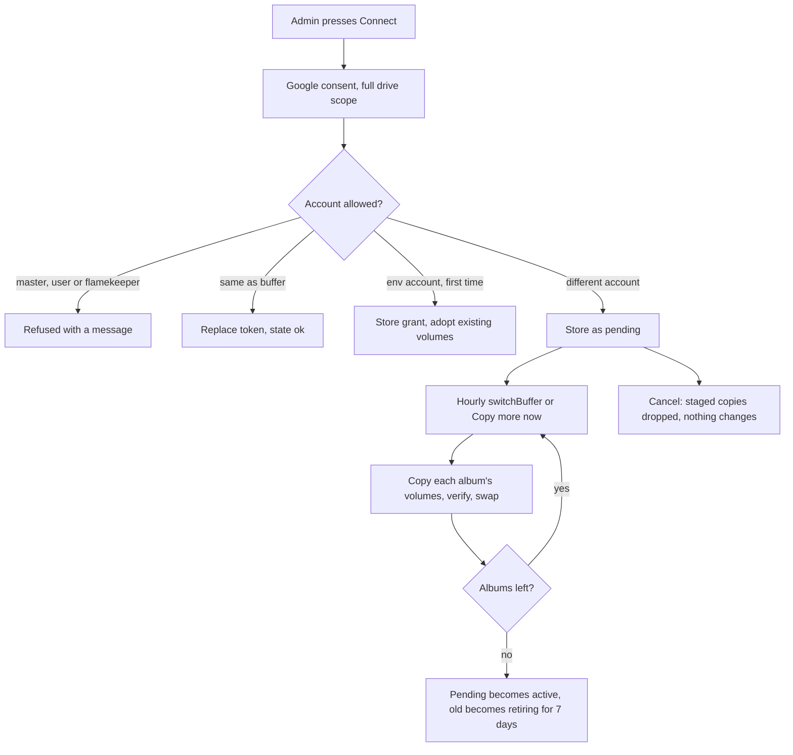
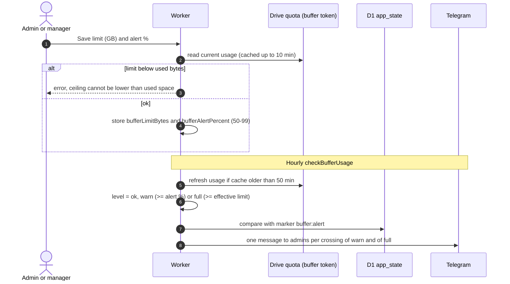
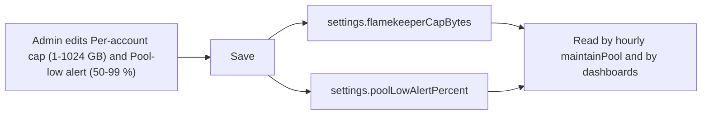

# Storage settings

`/admin/settings/storage` has a Buffer section (admins and managers) and a Flamekeepers section (admins only). Definitions: [GLOSSARY](../../../../GLOSSARY.md) (Buffer, Pool).

## How is the buffer account connected, switched or recovered?

- Only admins connect or cancel. The account must not be registered in the app, a flamekeeper or the master.
- A grant has a state: `ok`, `auth_failed` (revoked), `quota_full` or `missing` (volume folder gone). Anything but `ok` pauses uploads, adds a dashboard alert and sends one Telegram message. Reconnecting the same account clears it. Nothing switches or deletes automatically.
- Volume folders are named `V01<id>`, numbered per album.

## How are the buffer limit and alert set, and when are admins warned?

- The effective limit is the smaller of the configured limit and the Drive quota. Percent used is measured against the configured limit.
- At warn, `@nu.edu.kz` users see a banner asking for flamekeepers; at full, uploads are refused ([ADR-0015](../../../adr/0015-buffer-is-stable-photo-storage.md)). Dropping back to ok clears the marker so the next crossing alerts again.

## How are the flamekeeper cap and pool-low alert set?

Managers do not see this section. How the pool and its alert work: [../flamekeepers/pool.md](../flamekeepers/pool.md).
