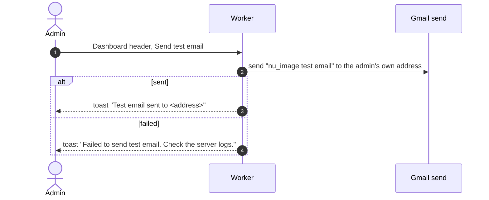

# Test email

## How does an admin check that the app can send email?

Admin only. The recipient is always the signed-in admin, never a chosen address. Flamekeeper reconnect and graduation emails use the same sender ([account card](../../flamekeeper/account/account-card.md)).
