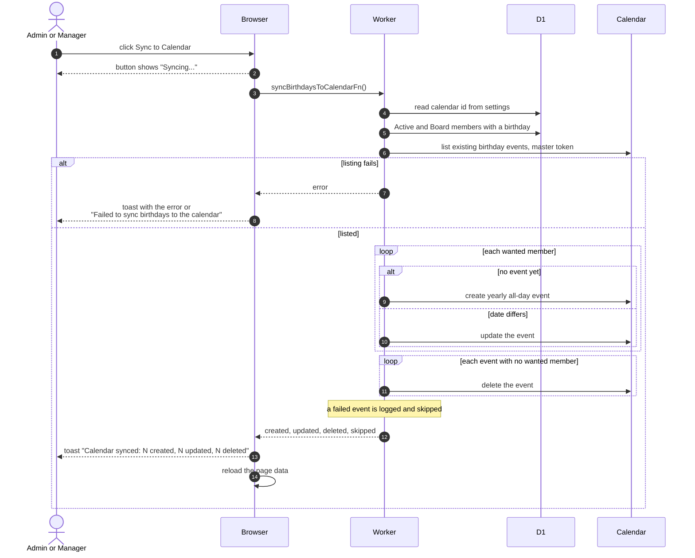

# Sync Birthdays To The Calendar

> **Question:** What happens when an admin or manager presses Sync to Calendar on the Birthdays page?
>
> **Answer:** The server makes the birthdays Google Calendar match the member list. Each Active or Board member with a readable birthday gets one yearly all-day event named with a cake and their name. Missing events are created, events with a wrong date are corrected and events for people who no longer qualify are deleted. A toast shows how many were created, updated and deleted. The same sync also runs by itself whenever a member's status changes.
>
> **Notes:**
> - The calendar is the ID saved in the dashboard Settings, or a built-in default when that field is empty, see [dashboard-settings.md](dashboard-settings.md).
> - Events are matched to members by an id kept in each event's description. Events without it are left alone. The event year is always 2000 and repeats every year.
> - The calendar is read in one request of up to 2500 events. Calls to Google use the club master account. One failed event is logged, counted as skipped and does not stop the others. Members whose birthday cannot be read are also counted as skipped. The toast does not show the skipped count.
> - If the calendar cannot be listed at all, the whole sync fails and the toast says "Failed to sync birthdays to the calendar" or the server's message.
> - The same reconcile also runs after onboarding and after a member edits their own profile, see [../account/onboarding-profile.md](../account/onboarding-profile.md) and [../account/profile-edit.md](../account/profile-edit.md).

