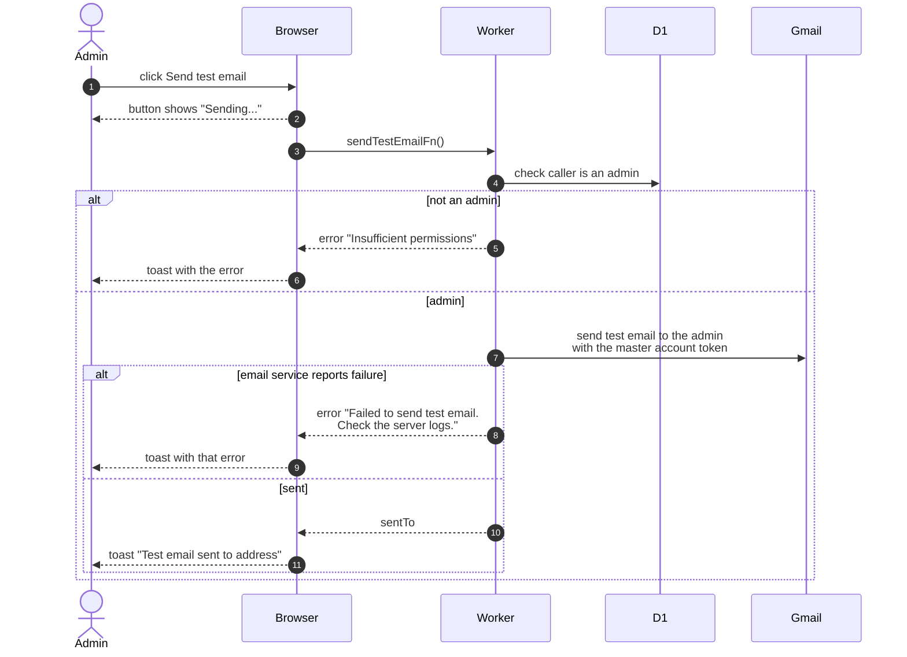

# Send A Test Email

> **Question:** How does an admin check that the club can send email?
>
> **Answer:** The admin opens Send test email on the dashboard. The server sends a short message to the admin's own address and the page shows a toast naming that address. If the email service reports a failure, the toast says to check the server logs.
>
> **Notes:**
> - The button is shown to admins only. A manager who calls the function gets "Insufficient permissions".
> - The message goes only to the person who pressed the button, never to other members. It is sent through Gmail from the club master account.
> - The subject is "nu_image test email" and the body states the time it was sent.

