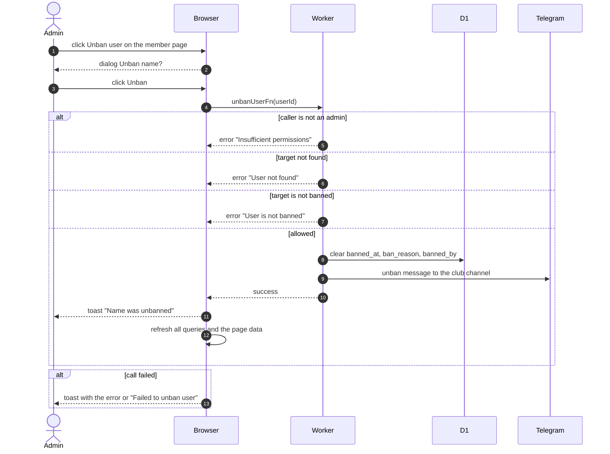

# Unban A Member

> **Question:** What happens when an admin lifts a member's ban?
>
> **Answer:** The admin opens the banned member's page, presses Unban user and confirms. The ban date, reason and banning admin are cleared, the person can sign in again, and the club channel gets an unban message. The admin sees the toast "Name was unbanned". Bookings that were cancelled stay cancelled and flamekeeping is not restored, so the person must connect their Drive again themselves.
>
> **Notes:**
> - Admin only. The Ban section is never shown to a manager.
> - Sessions deleted by the ban are not brought back. The person signs in fresh.
> - The channel message is skipped quietly if channel logging is off.
> - The ban itself is in [ban-member.md](ban-member.md).

