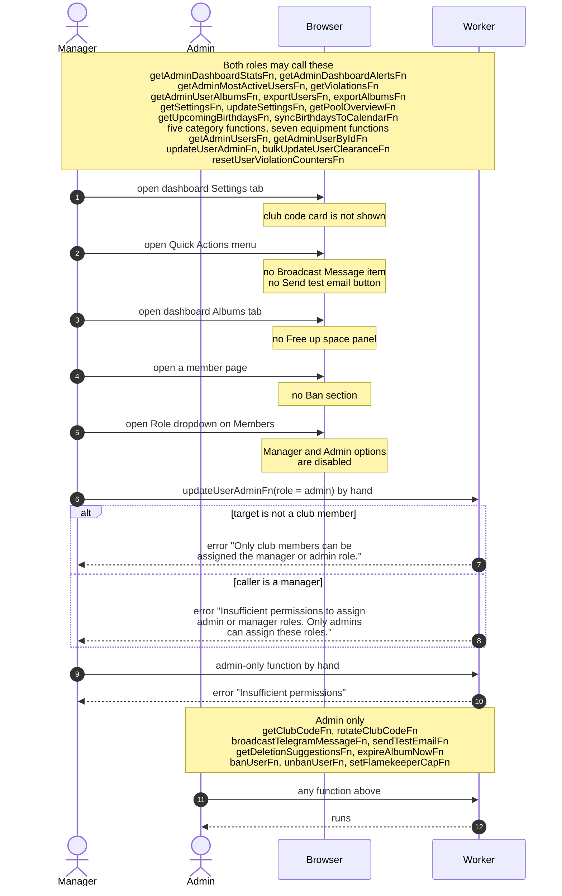

# Admin And Manager Permissions

> **Question:** Which admin actions can a manager do, and which are only for admins?
>
> **Answer:** Managers can do day-to-day running of the club: dashboard, Club Members (members, birthdays, violations), Equipment (equipment and categories), settings and exports. Admins can do all of that plus the actions that reach every member or change who gets in: broadcast, test email, club code, free-space expiry, bans, and assigning the manager or admin role. A manager who tries an admin-only call gets "Insufficient permissions". The buttons for those actions are hidden or disabled for managers, so the error appears only if the call is made by hand.
>
> **Notes:**
>
> - Only club members can hold the manager or admin role. The check applies to admins as well.
> - Setting someone's role back to Member is allowed for managers. Only the two elevated roles are blocked.
> - The flamekeeper pool cap is admin only. Its screen is in [../flamekeepers/admin-pool.md](../flamekeepers/admin-pool.md) and booking oversight is in [../bookings/admin-bookings-list.md](../bookings/admin-bookings-list.md).
> - The gate that runs before all of this is in [route-gate.md](route-gate.md).

