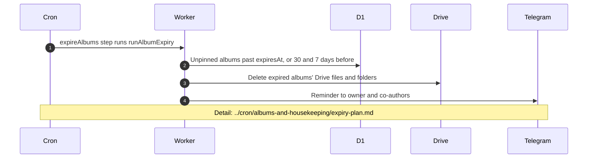

# What runs in the background for albums

> **Question:** Which album tasks happen on their own after an album exists, and where are they described?
>
> **Answer:** One cron step touches albums directly: the hourly one that deletes albums that reached their expiry date and sends 30 day and 7 day Telegram reminders. The photo indexer that ran every 5 minutes was removed in #25, together with the photo table. The flamekeeper steps no longer change albums: nobody holds photos on a flamekeeper, so the drain, relay and 7-day drop were removed in #24 (last `dev` commit containing them: `2565826`). This file only shows the hand-offs and names the file with the detail.
>
> **Notes:**
> - Expiry date is the event date plus 2 years, set at creation and moved when the event date is edited (unless the album is pinned), see create-album.md and edit-album-and-pin.md. Pinned albums are skipped.
> - An expired album keeps a small "deleted" record, so its link shows a notice instead of "Album not found", see view-album.md. The reason can be expired, flamekeeper_left, flamekeeper_lost or no_space.
> - Expiry removes at most 3 albums per hourly run. Reminders go to the owner and to co-authors who have Telegram.
> - Older albums need no background step, see legacy-albums.md.
> - Flamekeeper health checks are in ../cron/flamekeepers/health-probe.md.

