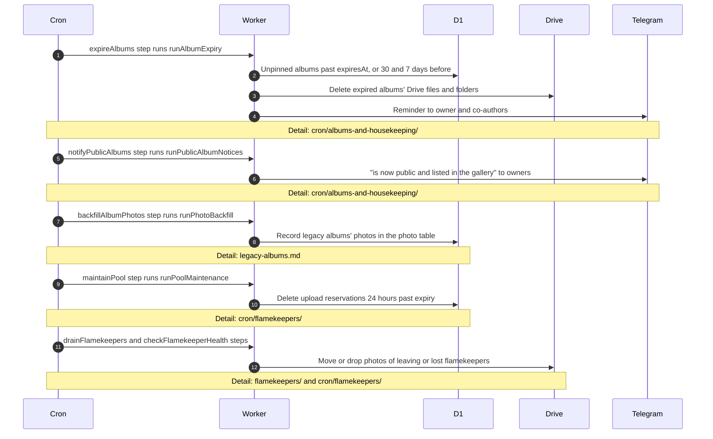

# What runs in the background for albums

> **Question:** Which album tasks happen on their own after an album exists, and where are they described?
>
> **Answer:** Four steps of the 5-minute cron touch albums: one deletes albums that reached their expiry date and sends 30 day and 7 day Telegram reminders, one tells owners their older albums are now public, one indexes legacy albums into the photo table, and one cleans old upload reservations. Photos are also moved between flamekeepers' Drives when a flamekeeper leaves, loses access or is drained. This file only shows the hand-offs. The detail lives in the folders named in the diagram.
>
> **Notes:**
> - Expiry date is the event date plus 2 years, set at creation and moved when the event date is edited, see create-album.md and edit-album-and-pin.md. Pinned albums are skipped.
> - An expired album keeps a small "deleted" record, so its link shows a notice instead of "Album not found", see view-album.md. The reason can be expired, flamekeeper_left, flamekeeper_lost or no_space.
> - Expiry removes at most 3 albums per run. Reminders go to the owner and co-authors who have Telegram.
> - Indexing is explained in legacy-albums.md.
> - Moving photos between Drives is in flamekeepers/ and cron/flamekeepers/ and is not redrawn here.

