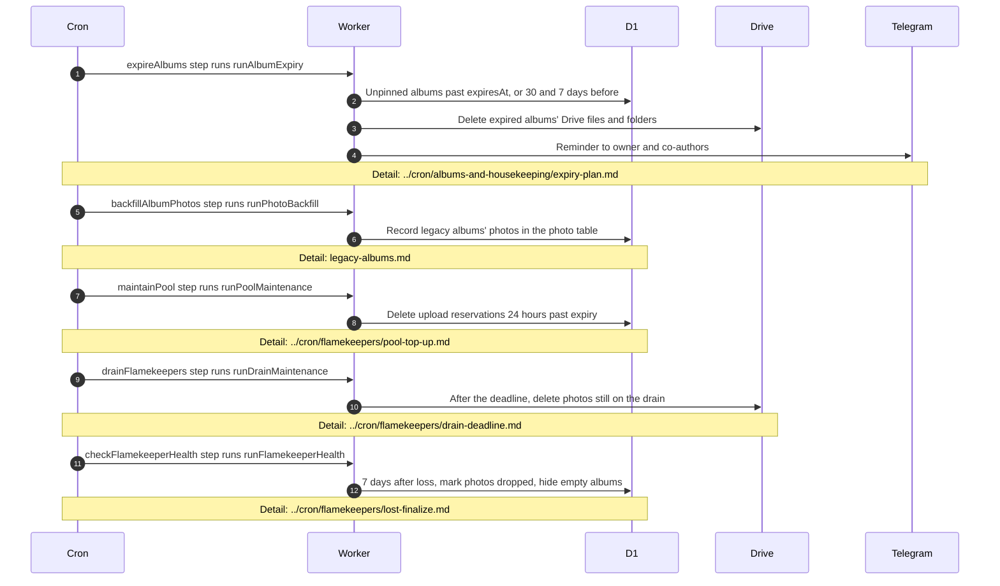

# What runs in the background for albums

> **Question:** Which album tasks happen on their own after an album exists, and where are they described?
>
> **Answer:** Three steps of the cron touch albums directly. The hourly cron has one that deletes albums that reached their expiry date and sends 30 day and 7 day Telegram reminders, and one that deletes old upload reservations. The 5-minute cron has one that records legacy albums' photos in the photo table until its removal. Two more hourly flamekeeper steps also change albums. The drain step emails flamekeepers and alerts admins about drains, and after a drain deadline it deletes the photos still left. The health step marks a flamekeeper lost when Google no longer accepts their connection, and after 7 days it drops that flamekeeper's photos from the albums and hides albums left empty. The cron never moves photos between Drives. Moving is done in the browser of a flamekeeper or admin. This file only shows the hand-offs and names the file with the detail.
>
> **Notes:**
> - Expiry date is the event date plus 2 years, set at creation and moved when the event date is edited (unless the album is pinned), see create-album.md and edit-album-and-pin.md. Pinned albums are skipped.
> - An expired album keeps a small "deleted" record, so its link shows a notice instead of "Album not found", see view-album.md. The reason can be expired, flamekeeper_left, flamekeeper_lost or no_space.
> - Expiry removes at most 3 albums per hourly run. Reminders go to the owner and to co-authors who have Telegram.
> > - The reservation cleanup deletes a reservation 24 hours after its expiry time. A reservation expires 2 hours after it is made.
> - Indexing legacy albums is explained in legacy-albums.md.
> - Photos moved between flamekeepers by the browser are in ../flamekeepers/relay-move-photo.md. Drive-side checks and the 7 day drop are in ../cron/flamekeepers/health-probe.md and ../cron/flamekeepers/lost-finalize.md.

