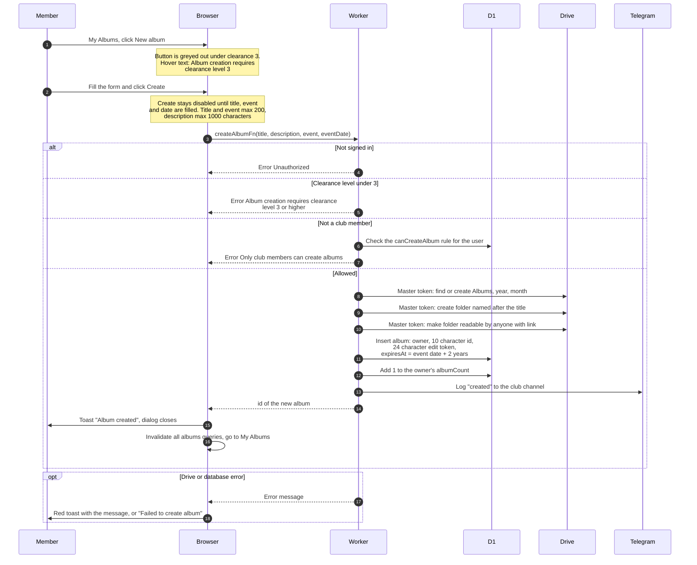

# Create an album

> **Question:** What happens when a member creates a new album, and whose Google Drive holds it?
>
> **Answer:** A club member with clearance level 3 or higher fills in title, event, event date and an optional description. The Worker uses the club's master Google account to create the folder Albums / year / month / title in the master's Drive and makes it readable by anyone with the link. It saves the album with an expiry 2 years after the event date and a fresh edit token, then the member lands on My Albums with the toast "Album created". The empty folder lives in the master account, and no photos are stored there. Each photo goes to a flamekeeper's Drive later, when it is uploaded.
>
> **Notes:**
> - The master account `nu_image` never holds uploaded photos. It only owns the album folder and the "Volume" sub-folders that flamekeepers upload into, see upload-start.md.
> - No flamekeeper is chosen at creation. The flamekeeper is chosen per photo.
> - The month folder uses the current UTC date, not the event date.
> - The album is saved as already indexed, so it is read from the photo table from the start. Older albums are not, see legacy-albums.md.
> - If the database save fails after the Drive folder was made, the empty folder stays in Drive and no album row exists.
> - Expiry and reminders are handled by cron, see ../cron/albums-and-housekeeping/.
> - The Telegram log line is only sent when channel logging is enabled.

