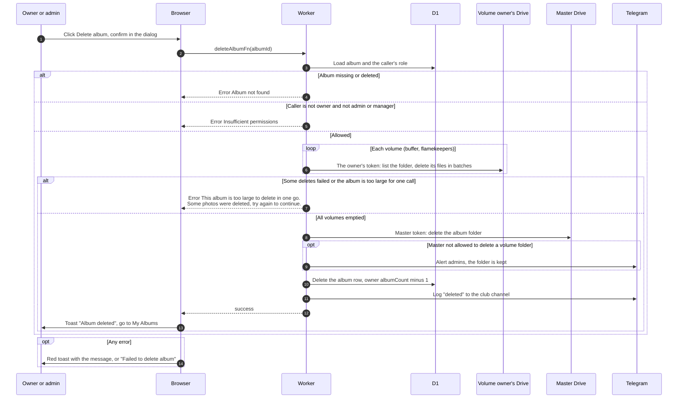

# Delete an album

> **Question:** What happens when the owner or an admin deletes an album?
>
> **Answer:** Only the owner or an admin or manager can delete. The Worker first lists each volume folder (the buffer's and any flamekeeper's) with that owner's own token and deletes the files it finds, then deletes the album folder with the master token, then removes the album row (and with it the co-author links, favorites and volume rows) and lowers the owner's album count. There is no photo table to consult, what is left in Drive is the progress. The page shows "Album deleted" and returns to My Albums. A very large album is deleted in rounds and the member is told to try again. If some files or folders cannot be cleared, the folder is kept and the person sees an error or admins get a Telegram alert.
>
> **Notes:**
> - There is no backup. The dialog says this permanently deletes the album, all its photos from Google Drive, and removes all co-authors.
> - A gone folder is different: an admin deletes it as a tombstone without touching any files, see deleted-folder-warning.md.
> - Deleting by hand removes the row completely. Expiry (cron) keeps a tombstone row instead, see cron/albums-and-housekeeping/.
> - Volume folders that the master account cannot delete are emptied first with their owner's token. If that is not finished in one go, the person sees "This album is too large to delete in one go. Some photos were deleted, try again to continue." If some folders stay blocked, admins get a Telegram alert, the album row is still removed and the person sees "Album deleted".
> - If a flamekeeper's Google connection is lost, their files cannot be listed or deleted and are left where they are. The album row is still removed.
> - Only the album owner's album count goes down. Co-authors' counts are not changed.
> - If Drive refuses to delete the folder for another reason, the failure is only logged and the album row is still removed.

