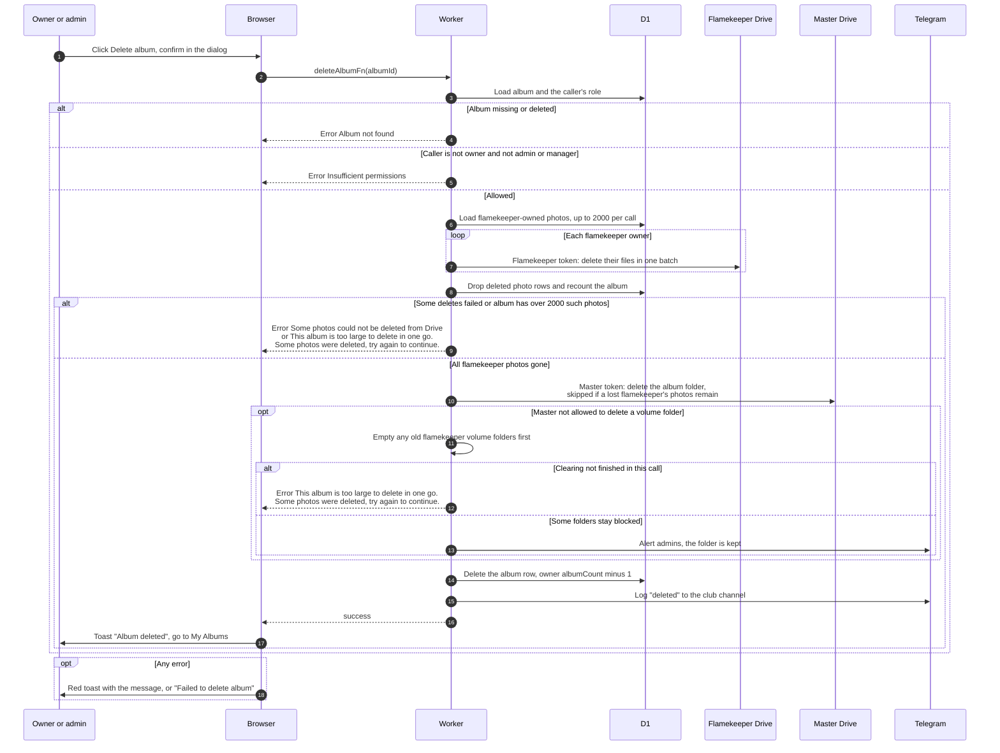

# Delete an album

> **Question:** What happens when the owner or an admin deletes an album?
>
> **Answer:** Only the owner or an admin or manager can delete. The Worker first deletes the photos held in flamekeepers' Drives, using each flamekeeper's own token, then deletes the album folder with the master token, then removes the album row (and with it the photo rows and co-author links) and lowers the owner's album count. The page shows "Album deleted" and returns to My Albums. A very large album (over 2000 flamekeeper photos) is deleted in rounds and the member is told to try again. If some photos or folders cannot be cleared, the folder is kept and the person sees an error or admins get a Telegram alert.
>
> **Notes:**
> - There is no backup. The dialog says this permanently deletes the album, all its photos from Google Drive, and removes all co-authors.
> - A gone folder is different: an admin deletes it as a tombstone without touching any photos, see deleted-folder-warning.md.
> - Deleting by hand removes the row completely. Expiry (cron) keeps a tombstone row instead, see cron/albums-and-housekeeping/.
> - Volume folders that the master account cannot delete are emptied first through each flamekeeper, if an old one still has files. If that is not finished in one go, the person sees "This album is too large to delete in one go. Some photos were deleted, try again to continue." If some folders stay blocked, admins get a Telegram alert, the album row is still removed and the person sees "Album deleted".
> - If a flamekeeper's Google connection is lost, their photos are dropped from the table and the album's Drive folder is kept. The album row is still removed.
> - Only the album owner's album count goes down. Co-authors' counts are not changed.
> - If Drive refuses to delete the folder for another reason, the failure is only logged and the album row is still removed.

