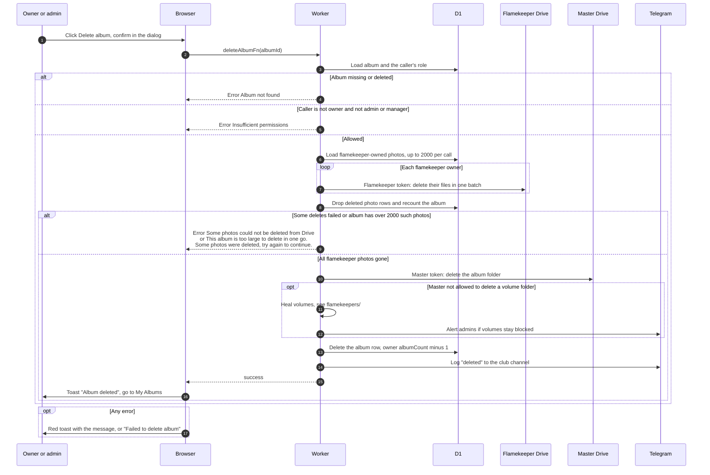

# Delete an album

> **Question:** What happens when the owner or an admin deletes an album?
>
> **Answer:** Only the owner or an admin or manager can delete. The Worker first deletes the photos held in flamekeepers' Drives, using each flamekeeper's own token, then deletes the album folder with the master token, then removes the album row and lowers the owner's album count. The page shows "Album deleted" and returns to My Albums. A very large album (over 2000 flamekeeper photos) is deleted in rounds and the member is told to try again. If some photos or folders cannot be cleared, the folder is kept and the person sees an error or admins get a Telegram alert.
>
> **Notes:**
> - There is no backup. The dialog says this permanently deletes the album, all its photos from Google Drive, and removes all co-authors.
> - Deleting by hand removes the row completely. Expiry (cron) keeps a tombstone row instead, see cron/albums-and-housekeeping/.
> - Volumes that the master account cannot delete are cleared by the healing step described in flamekeepers/ and cron/flamekeepers/.
> - If a flamekeeper's grant is lost, their photos are dropped from the table and the Drive folder is kept so nothing is left half deleted.
> - If Drive refuses to delete the folder for another reason, the failure is only logged and the album row is still removed.

