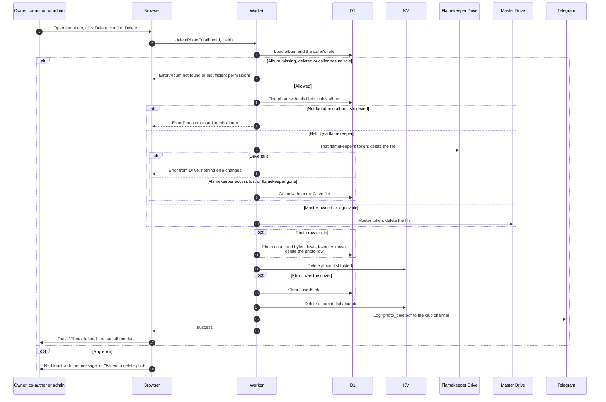

# Delete a photo

> **Question:** What happens when a member deletes one photo, and whose Google token removes the file?
>
> **Answer:** The owner, co-authors and admins or managers can delete a photo from the photo viewer after confirming "Delete photo?". The Worker finds the photo in this album's table. If a flamekeeper holds the file, it is deleted with that flamekeeper's own token. If it is a master-owned or older file, it is deleted with the master token. Then the photo row goes, the album's photo count, size and favorite count go down, a cover that pointed at this photo is cleared, and the page shows the toast "Photo deleted".
>
> **Notes:**
> - Ownership checks, in order: the caller needs a role on this album, and the file id must belong to a photo of this same album, so a photo id from another album is refused with "Photo not found in this album".
> - For a legacy album that is not indexed, a file id with no row is not refused. It is deleted from Drive with the master token as given. See legacy-albums.md.
> - A deleting caller's own token is never used. Admins deleting someone else's photo still delete it through that flamekeeper's token.
> - If the flamekeeper's access was lost or the flamekeeper is gone, the row is removed without the Drive file. If Drive fails for another reason, the error is shown and nothing is removed from the table.
> - The photo viewer and the dialog text say the photo is removed "from the album and your Drive storage".
> - Favorites of this photo are removed with the row.

