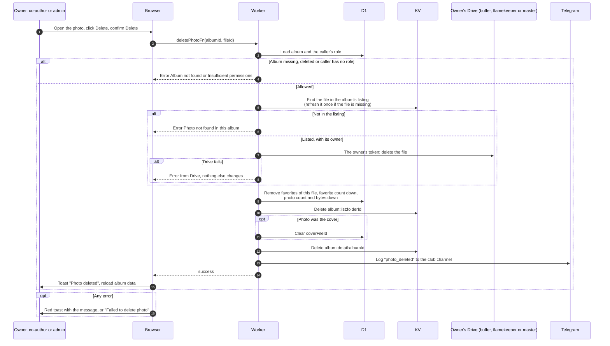

# Delete a photo

> **Question:** What happens when a member deletes one photo, and whose Google token removes the file?
>
> **Answer:** The owner, co-authors and admins or managers can delete a photo from the photo viewer after confirming "Delete photo?". The Worker finds the file in this album's listing, which also says whose token can delete it. If the buffer holds the file, it is deleted with the buffer's token and the volume's expected count and bytes go down. If a flamekeeper holds it, it is deleted with that flamekeeper's own token and their used bytes go down. If it is a master-owned or older file, it is deleted with the master token. Then the album's photo count and size go down, its favorites of this file are removed and the favorite count drops with them, a cover that pointed at this photo is cleared, and the page shows the toast "Photo deleted".
>
> **Notes:**
> - Ownership checks, in order: the caller needs a role on this album, and the file id must be in this same album's listing (a cached listing that misses it is refreshed once), so a file id from another album, or any other Drive file, is refused with "Photo not found in this album" and no token is used on it. The listing only covers this album's own folders and only image files.
> - A deleting caller's own token is never used. Admins deleting someone else's photo still delete it through that flamekeeper's token.
> - If the owner's token cannot be used (for example a flamekeeper's access was lost), the error is shown and nothing changes.
> - The photo viewer and the dialog text say the photo is removed "from the album and your Drive storage".
> - Favorites of this photo are removed, and the album's favorite count goes down by that many.

