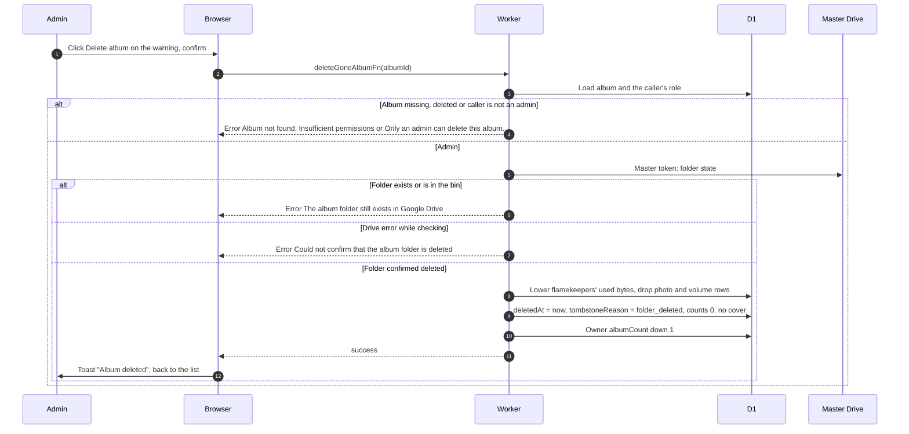

# Warning for a trashed or deleted album folder

> **Question:** What do owners and admins see when an album's Drive folder is in the bin or permanently deleted, and what can an admin do about it?
>
> **Answer:** The manage panel shows a warning with an "Open in Google Drive" link: "Album folder is in the Google Drive bin" or "Album folder deleted from Google Drive". Uploads are paused while the warning shows. There is no restore or recreate button, the app never changes the folder. If the folder is only in the bin, the owner can take it out of the bin in Drive. If it is permanently gone, an admin sees a "Delete album" button. The Worker re-checks with the master token that the folder is really gone, then replaces the album with a tombstone (reason "folder_deleted") and lowers the owner's album count. Photos still held in flamekeepers' Drives are left untouched and are no longer managed by the app. The page shows "Album deleted".
>
> **Notes:**
> - Only users with role admin can delete a gone album. Managers see the warning but not the button.
> - The check must come back "deleted". A folder that exists, is in the bin, or a Drive error while checking is refused, so doubt never removes an album.
> - Nothing is deleted in Drive. Rows in the photo and volume tables for the album are dropped and the flamekeepers' used bytes are lowered by what the album held.
> - The folder state is noticed the next time the album core is rebuilt, up to an hour unless Refresh is used, see refresh-album.md.
> - The tombstone page text comes from tombstoneCopy in `src/lib/pool/expiry.ts`. The ordinary owner delete in delete-album.md still deletes photos, it is not used for gone folders.

